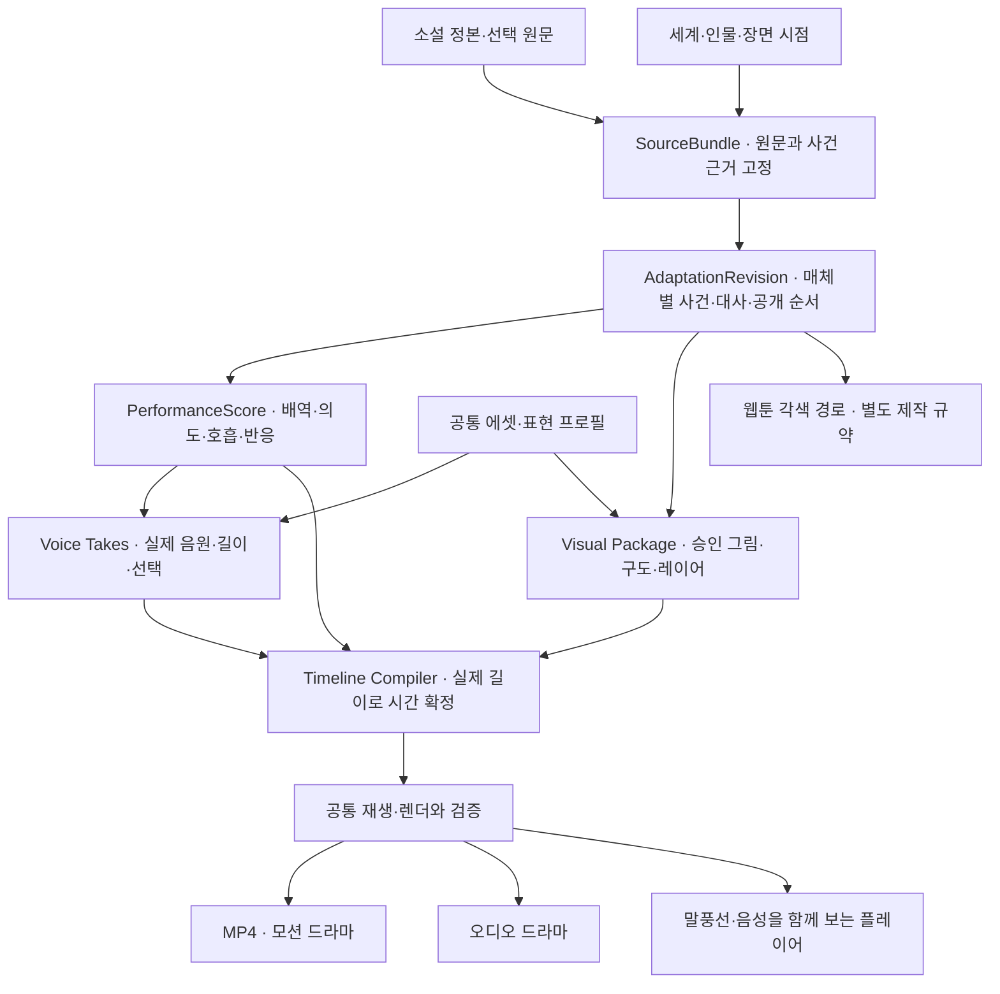

# 소설에서 공연 가능한 장면으로 — vibelore 매체 제작 아키텍처 제안

작성: 2026-10-08. 현재 작업 트리의 코드·운영 규약과 공식 API 문서를 조사한 설계 보고서다. 구현 완료 명세가 아니다. 유료 음성·이미지·영상 API 호출이나 실제 한국어 연기 비교 실험은 하지 않았다. 기존 변경 사항, 소설 정본, `.vibelore/`는 수정하지 않았다.

## 1. 권고

**소설의 사건을 근거로 매체별 각색판을 만들고, 인물의 연기·화면·소리를 장면 단위로 조립하는 제작기를 추가한다.** 첫 결과물은 성우 배역과 카메라 연출이 있는 60~90초 모션 드라마다. 영상 생성 모델 없이 이미지·음성·편집으로 만든다. 같은 제작 기반에서 오디오 드라마, 모션 코믹, 세로 영상, 예고편을 확장한다.

현재 소설 집필과 웹툰 제작은 그대로 유지한다. 웹툰 완료를 영상 제작의 필수 선행 조건으로 만들지 않는다. 소설의 내면 묘사는 음성·침묵·시선으로 옮겨야 하므로, 영상은 소설에서 직접 각색하는 편이 자연스럽다. 기존 웹툰을 낭독·재생하는 경로도 별도로 지원한다.

가장 중요한 새 데이터는 `PerformanceScore`, 즉 **이 대사가 누구에게 무엇을 하려는 말인지, 어디서 감정이 새는지, 누가 언제 반응하는지**다. `emotion: angry`만으로는 티키타카를 만들기 어렵다. 이 자료가 TTS 연기 지시와 카메라·반응 컷을 함께 결정하게 한다.

세계는 소설 없이도 존재할 수 있다는 기존 개념을 유지한다. 이번 본편 제작은 소설의 사건 순서와 서술을 원천으로 삼는다. 인물 소개집이나 세계관 자료는 공유 설정에서 직접 만들 수 있다. 영상에서 새로 만든 표정·음색·대사는 공유 정본으로 자동 역수입하지 않는다.

## 2. 현재 있는 것과 실제 빈 곳

| 현재 기반 | 확인한 코드·규약 | 이번 확장에서의 의미 |
|---|---|---|
| 원천 판본과 문단 ID·해시 | `src/core/production-source.js`, `src/store/webtoon-store.js` | 소설의 어떤 구간을 썼는지 연결할 수 있다 |
| 장면별 세계선·시점·인물 상태 | `engine/src/lore/production.js`, `engine/src/lore/script.js` | 회상의 인물을 현재 외형으로 그리는 오류를 막는 기반 |
| 독립 장면 대본과 봉인 입력 | `src/core/scene-script.js`, `src/core/input-objects.js` | 세계 경로가 사라져도 채택된 대본과 참조 바이트를 확인할 수 있다 |
| 승인 에셋·표현 프로필·불변 개정 | `engine/src/lore/assets.js`, `src/store/asset-catalog-store.js` | 인물 정체성과 이미지 개정·화풍 선택을 분리한다 |
| 생성 전 검토·실제 이미지 검토·제작 이력 | `src/tools/webtoon-scene.js`, `docs/reference/WEBTOON_WORKFLOW.md` | 검사된 입력과 실제 결과를 묶는 원칙을 재사용한다 |
| 미래 modality 슬롯 | `engine/src/core/types.js`, `engine/src/generators/generator.js` | audio/video 식별은 있으나 제작 엔진 구현은 아니다 |

현재 에셋 계약은 `purpose: reference-image`, PNG/JPEG, 이미지 크기 메타데이터만 지원한다. WAV·오디오 길이·타임라인·음성 배역·인물 마스크는 없다. 표현 프로필의 casting도 구조화된 성우 배역 계약은 아니다. 독립 장면 대본에는 정확한 장면 text가 있지만 소설 문단→각색 문장별 변환 근거와 공연 데이터는 없다.

소설 원천 경로와 봉인된 장면 대본 경로의 보존 강도도 다르다. `docs/reference/SHARED_LORE_RUNTIME.md`는 소설 입력을 완전 봉인 재현으로 주장하지 않는다. 새 매체 제작에서는 선택한 소설 원문·원작 대응표·당시 필요한 설정까지 보존하는 `SourceBundle`을 먼저 보강한다. 과거 제작물의 보존 상태를 소급해서 바꾸지 않는다.

기존 소설 snapshot은 일부 인물 문서를 `current-document-not-as-of-scene`으로 표시한다. 이를 장면 당시의 확정 상태로 승격하지 않는다. 회상·성장 장면에서는 승인된 상태 lock이나 원작 근거로 resolve하고, 필요한 외형·지식이 아직 불명확하면 그 선택을 해소한 뒤 생성한다. provider에는 해당 작업에 필요한 원문·참조만 전달하며 credential은 manifest·공연 대본·검토 로그에 저장하지 않는다.

현재 새 웹툰은 **문자를 포함한 장면 통합 이미지**, 승인된 OpenAI 이미지 API 경로를 사용한다. 아래 Google 이미지 경로는 새 매체 에셋 제작 Adapter 제안이다. 현 웹툰의 모델 선택이나 제작 순서를 바꾸거나 deprecated 컷별 경로를 되살리는 제안이 아니다.

저장소에 이전 영상·TTS·공통 에셋 조사 보고서는 남아 있다. 운영 소스에서 예전 Google 음성과 영상 조립 구현은 확인하지 못했다. 기존 보고서의 feasibility 판단과 실제 재사용 가능한 코드의 존재를 구별한다.

## 3. 전체 구조



공유하는 것은 원천·장면·인물 식별과 근거, 승인 에셋이다. **매체마다 같은 각색을 강요하지 않는다.** 오디오판은 보이지 않는 동작을 소리나 짧은 서술로 보완하고, 영상판은 눈빛을 보여주며 설명을 줄인다. 웹툰의 칸 수, 영상의 초 수, 오디오의 호흡은 각각 다른 편집 계약이다.

공통 이야기 층을 너무 크게 정규화하지 않는다. 원문, 안정적인 scene/beat ID, 사건 근거, 선택한 상태, 공개 제약 정도부터 공유하고 실제 요구가 생긴 필드만 구조화한다.

## 4. 데이터 계약: 일곱 가지 판본

| 기록 | 소유하는 내용 | 고정하는 주요 의존성 |
|---|---|---|
| `SourceBundle` | 선택 원문, 화·문단·문장 근거, 출입 상태, 사용 가능한 설정과 공개 범위 | 원작 판본, 실제 원문 bytes, 장면 상태 lock |
| `AdaptationRevision` | 사건 선별, 압축·생략 이유, 발화·서술·행동, 매체 목적 | source hash, 표현 방향, 원작 대응표 |
| `CastRevision` | 배역→provider/model/voice, 기본 음색 지시, 발음 사전, 채택 샘플 | 인물 정체성, 적용 언어·상태, 실제 샘플 bytes |
| `PerformanceScore` | 의도·하위 텍스트·호흡·상대·반응·겹침·억제되는 감정 | 각색 문장, 배역 판본, 장면 전후 관계 |
| `VisualPackage` | 샷, 배경·인물 이미지, 보호 영역, 마스크·초점·카메라 허용 범위 | 인물 상태, 화풍 판본, 실제 이미지 bytes |
| `TimelineRevision` | 발화·침묵·반응·카메라·자막·효과음의 시간과 의존성 | 선택 take hash와 sample 수, performance, visual package |
| `ProductionManifest` | 완료 파일, 사용 판본, 도구 버전, 검사·검토·선택·비용 기록 | 위 전체 입력과 최종 파일 bytes |

자산은 `Asset → Revision → Representation`으로 나눈다. 인물 A의 성인기 정체성은 이미지 파일 개정과 다르다. 같은 배역의 샘플 WAV, 편집용 WAV, 배포용 AAC도 다른 Representation이다. 현재 이미지 스키마를 느슨하게 덧붙이지 않고 versioned union으로 이행한다. 구형 이미지 판본은 기존 검사기를 유지한다.

배역은 character가 아니라 **character + 언어 + 승인 표현 + 적용 상태**에 연결한다. 성장 전후나 회상에서 음색을 달리할 수 있지만, 등장마다 감정 때문에 voice ID가 바뀌지는 않는다. 내면 음성·나레이션·일반 발화도 역할을 구별한다. 모델·음성 이름이 폐기되어도 채택 샘플과 이미 제작한 음원은 남는다.

각색 문장에는 최소한 `sourceRefs`, `transformation`, `speaker`, `textDisplay`, `textSpoken`, `newFactClaims`를 둔다. 원문 대사를 유지하는 모드는 원문과 정확히 대조한다. 새로운 영상용 대사나 서술 압축은 승인된 각색 선택으로 기록한다. 발음 표기를 바꾸는 것과 이야기 문구를 바꾸는 것을 구별한다.

`spoilerCeiling` 하나로 모든 공개를 해결하지 않는다. 같은 화 안에서도 샷·발화의 공개 순서가 있다. 숨겨진 정체, 아직 읽히면 안 되는 문서, 다음 칸의 반전, 속마음의 음성화는 장면별 `revealPolicy`에 연결한다. 인물이 아는 사실과 관객에게 공개할 사실도 구별한다.

## 5. 모델 배치

아래는 **공식 문서에서 기능·식별자를 확인한 후보와 설계상 권고**다. 모델 사이의 한국어 문학 각색·성우 연기 우열을 실측했다는 뜻은 아니다. 출시·계정 접근 가능성은 제작 시작 시 다시 조회한다. 별도 [API 조사](google-media-production-api-review-2026-10-08.md)에 endpoint·상태·가격 근거를 정리한다.

| 역할 | 권고 시작점 | 입력·출력과 선택 이유 |
|---|---|---|
| 각색·장면 연출·공연 대본 | 현재 연결한 집필 모델 유지. Google 전용 실행은 `gemini-3.8-flash` 후보 | 선택 원문과 장면 상태→구조화 각색판·공연 지시. API 전환보다 원작 이해를 먼저 보존 |
| 저비용 추출·형식 보완 | `gemini-3.5-flash-lite` 후보 | 출처 대응·발음 후보·단순 메타데이터. 중요한 각색 선택은 맡기지 않음 |
| 원작·정보 공개·연출 검토 | 별도 검토 요청. Google 후보는 `gemini-3.8-flash`; 어려운 사례는 `gemini-3.1-pro-preview` 비교 | 원문·현재 대본·실제 결과를 보고 근거 있는 finding. 후보 모델의 Preview 여부를 기록 |
| 표정·샷·배경 이미지 | `gemini-nano-banana-2.1` 후보, 중요한 기준 그림은 `gemini-3-pro-image` 비교 | 승인 인물·장소 참조→문자 없는 영상용 그림. 기준 외형과 실제 결과를 비교 |
| 연기 음성 | Developer API `gemini-3.8-flash-tts`; 초안 비용 경로는 `gemini-3.8-flash-lite-tts` 비교 | 고정 원문·배역·스타일→음원. final은 모델명을 바꿨다는 이유가 아니라 실청취로 take 선택 |
| Cloud 운영 경로 | Cloud TTS `gemini-2.5-flash-tts` / `gemini-2.5-pro-tts`를 별도 선택지로 유지 | Cloud 인증·쿼터·언어·입력 계약이 필요한 배포. Developer API와 모델 이름·요청 형식을 혼용하지 않음 |
| 발화 검증·시간 대응 | Cloud Speech-to-Text, 또는 `gemini-3.5-transcribe` 평가 | 실제 생성 음원을 역전사하고 시간 근거를 얻음. known transcript와 불일치를 검토 |
| 최종 합성 | Remotion + FFmpeg, 모델 사용 없음 | 실제 에셋과 시간표→공통 미리보기와 MP4·음성·자막 |
| 특별한 움직임 | 별도 이미지→영상 Adapter를 나중에 실험 | 선택한 짧은 행동·분위기 샷만 생성. 본편 대사와 음성은 기존 공연 계약 유지 |

[Google 현재 모델 목록](https://ai.google.dev/gemini-api/docs/models), [구조화 출력](https://ai.google.dev/gemini-api/docs/structured-output), [이미지 생성](https://ai.google.dev/gemini-api/docs/image-generation), [Developer TTS](https://ai.google.dev/gemini-api/docs/speech-generation), [Cloud Gemini-TTS](https://docs.cloud.google.com/text-to-speech/docs/gemini-tts).

구조화 JSON은 형식 오류를 줄이는 기능이다. 원작을 제대로 각색했다는 의미 검증은 별도다. 최신 모델 이름을 인물·각색 데이터에 직접 박지 않고 `ModelPolicyRevision`에서 capability·실제 model ID·endpoint·가격표 기준일을 고정한다. 권한 오류나 품질 실패가 발생해도 모델·과금 경로를 조용히 바꾸지 않는다.

같은 호스트의 모델에게 다시 물은 검토는 자기검토다. 모델을 바꾸거나 다른 요청으로 나눴다는 이유만으로 독립 독자 평가라고 표시하지 않는다. 검토 영수증에는 실제 실행 주체와 열람한 자료를 기록한다.

## 6. 각색: 줄거리 요약보다 장면의 거래를 보존

각색 모델의 질문은 “이 화를 요약하라”가 아니라 다음이다.

1. 이 장면에서 누가 무엇을 얻으려 하고, 무엇을 숨기는가?
2. 어떤 발화·행동에서 힘의 관계나 관객의 예상이 바뀌는가?
3. 원작을 읽지 않은 사람이 이 장면만으로 원인과 결과를 이해하는가?
4. 설명을 줄였을 때 남겨야 할 정보는 대사·화면·소리 중 어디에 두는가?
5. 원작에 있지만 이번 판에서 생략할 사건과 그 이유는 무엇인가?

대사를 모두 낭독하고 내면 독백을 모두 내레이터에게 주면 작품이 설명 방송이 되기 쉽다. `show`, `say`, `sound`, `withhold`, `omit`을 선택하게 한다. `withhold`는 잠깐 침묵하거나 반응을 먼저 보여주는 연출이고, 근거 없는 사건 삭제와 다르다. 오디오판에서는 보이지 않는 반응을 소리로 재설계한다.

내레이터는 고유 배역이다. 누가 말하는지 혼동될 때, 시간·공간 압축이 필요할 때, 시점 인물의 내면이 감상 계약에 포함될 때 사용하는 정책을 고정한다. 이미 화면과 연기로 이해되는 감정을 다시 설명하지 않는 방향을 첫 실험에서 비교한다.

## 7. 연기와 티키타카

아래는 작품 정본과 무관한 설명용 가상 예시다.

> A: “왔네.” — 상대를 안심시키려 하지만 경계가 새어 나온다.
> B: “늦어서 미안.” — 사과하며 상대의 진심을 확인한다.

`PerformanceScore`에는 다음을 둔다.

```json
{
  "utteranceId": "u-a-01",
  "speakerId": "character-a",
  "textDisplay": "왔네.",
  "textSpoken": "왔네.",
  "intent": "상대를 안심시킨다",
  "subtext": "믿어도 되는지 아직 경계한다",
  "delivery": "짧고 낮게, 끝의 긴장을 조금만 남긴다",
  "respondsTo": "beat-arrival",
  "after": {"kind": "reaction", "targetId": "character-b", "preferredGapMs": 350},
  "cameraCue": {"kind": "reaction", "targetId": "character-b"}
}
```

이 수치는 편집 예시이지 최적의 호흡이나 모든 작품의 규칙이 아니다. 연기 prompt와 실제 발화 문자열을 분리하고 stage direction이 음원에서 낭독되는지 검증한다. 인물은 상대의 직전 발화와 현재 관계, 자신이 아는 사실만 문맥으로 받는다. 미래 설정과 숨은 정답을 일괄로 주어 연기로 스포일러를 드러내지 않게 한다.

기본은 발화 또는 같은 인물의 짧은 의미 묶음별 단일 화자 TTS다. 파일마다 화자·길이·take를 관리할 수 있어 부분 수정에 유리하다. 지나친 분절로 억양이 끊기면 연속 발화를 묶어 생성하고, 실제 정렬이 확인된 지점에서만 나눈다.

Developer TTS의 두 화자 대화 모드는 자연스러운 호흡의 비교 후보다. 한 파일의 두 화자를 트랙별로 분리해 주거나 정확한 발화 경계를 제공한다고 가정하지 않는다. 세 명 이상은 각각 생성해 공연 타임라인으로 조립한다. 서로 말을 덮는 연출은 명시한 겹침만 허용하고, 첫 검증 샘플에서는 과도한 겹침을 피한다.

현재 Developer 3.8 TTS는 Interactions endpoint를 사용하고, unary 기본 출력은 24kHz mono 16-bit WAV, streaming은 headerless PCM이다. `speech_metadata`의 index는 텍스트 위치이며 시간값이 아니다. voice design은 자체 배역 오디션 후보지만 저장된 provider voice는 1년 TTL이 있으므로 자체 `CastRevision`과 동일한 영구 식별자로 다루지 않는다. [TTS 계약](https://ai.google.dev/gemini-api/docs/speech-generation), [Interactions schema](https://ai.google.dev/api/interactions-api), [Voice design](https://ai.google.dev/gemini-api/docs/voice-design).

배역 오디션은 같은 한국어 문장으로 평상시·긴장·웃음을 누르는 상황·고유명사 발음을 비교한다. 이후 장면마다 오디션을 반복하지 않는다. 핵심 대사만 2~3 take로 비교하고 채택 이유를 기록한다. 목소리 유사도 수치만으로 배역 승인이나 동일성 보증을 하지 않는다.

## 8. 이미지와 움직임: 두 제작 경로

### 기존 웹툰을 살리는 빠른 경로

완성 장면 이미지의 칸 bbox·읽기 순서·text ID·인물 초점·보호 영역을 실제 이미지에서 대응시킨다. 현재 통합 이미지는 칸마다 독립 레이어나 정확한 crop 좌표를 보장하지 않는다. Vision 제안은 후보이며 첫 대응표는 눈으로 확인한다.

칸 전환·정지·작은 팬·줌을 적용하고 말풍선과 얼굴을 안전하게 유지한다. 전체 페이지가 뒤 칸의 반전을 미리 노출할 수 있어 처음부터 전체 장면을 보여주는 방식을 기본으로 삼지 않는다. 이미지 속 대사를 없애거나 얼굴만 확대하는 것은 별도 편집 작업이며 자동 crop의 부수 효과로 처리하지 않는다.

### 새 영상용 시각 패키지

배경 clean plate, 인물의 필요한 포즈·표정, 전경·효과, 초점·보호 영역을 분리한다. 2.5D 이동은 가려진 배경을 복원하고 alpha 마스크를 확인한 에셋에만 적용한다. 생성 모델이 투명 배경을 항상 올바르게 반환한다고 가정하지 않는다. 실제 alpha·가장자리·배경 오염·빈 영역을 검사한다.

첫 장면은 세로 또는 가로 중 한 기본 비율로 조립한다. 다른 비율은 인물·눈·손·자막을 포함할 수 있는지 별도 reframe한다. 한 16:9 파일을 가운데 잘라 모든 9:16 샷이 완성된다고 보장하지 않는다. 어울리지 않는 샷은 정지·여백·새 구도로 해결한다.

움직임은 표정 교체, 안전한 팬·줌, 배경과 인물의 다른 이동, 제한된 입·눈 상태 순으로 추가한다. 전 컷에 줌을 반복하는 방식은 권하지 않는다. 말을 듣는 사람의 반응 컷, 잠시 멈춤, 다음 대사가 시작된 뒤 화면을 바꾸는 편집으로 리듬을 만든다. 입모양은 MVP 필수가 아니다. 진정한 관절 운동이나 새 동작은 정지 이미지 합성만으로 해결되지 않는다.

## 9. 타임라인: 음성을 만든 다음 시간이 확정된다

LLM은 사건 순서·전환 이유·호흡의 선호를 제안한다. 실제 시간 확정은 코드가 한다.

1. 선택한 음원의 codec·sample rate·sample 수·앞뒤 침묵을 읽는다.
2. 편집한 trim 범위가 발음을 자르지 않는지 확인한다.
3. 발화 순서와 의도한 겹침, 명시적 반응·침묵을 제약으로 풀어 시간을 배치한다.
4. 실제 발화 시작·끝에 카메라·표정·자막 cue를 붙인다.
5. 발화 없는 행동과 여운을 추가한다. 목표 길이를 초과하면 각색으로 돌아가며 전 음성을 일괄 가속하지 않는다.

`after(u1, 350ms)`, `holdUntil(u2.end)`, `revealAfter(beat3)`, `cutOn(wordAnchor)` 같은 의미 anchor를 먼저 보존한다. 최종 타임라인은 integer audio sample과 integer video frame으로 컴파일한다. 소수 초를 계속 더해 누적 오차를 만들지 않는다. 30fps 화면과 48kHz 편집 음성은 출력 프로필의 시작 후보이며 원본 음성 포맷을 먼저 보존한다.

MVP 자막은 발화 단위다. 단어 강조가 필요해지면 음성 API의 실제 timestamps 계약을 확인하거나 정렬 단계를 추가한다. 역전사의 단어 시간은 이미 존재하는 원문에 대한 forced alignment와 동일하지 않다. 인식 결과를 원문에 대응시키고 고유명사·누락·반복을 확인한다. 검증되지 않은 시간에는 노래방 자막을 만들지 않는다. [Cloud 단어 시간 문서](https://docs.cloud.google.com/speech-to-text/docs/v1/async-time-offsets).

음향은 대사·내레이션·음악·환경·효과음을 별도 stem으로 남긴다. 대사 중 음악 ducking, scene 간 음량 차이, clipping·true peak를 검사한다. 통합 음량은 출력 프로필의 선택 값이며 작은 감정 발화까지 동일한 세기로 밀어 올리지 않는다. [FFmpeg 필터](https://ffmpeg.org/ffmpeg-filters.html).

## 10. 재생·렌더 구현

제품 편집기의 추천은 **같은 Remotion composition을 Player와 headless renderer에서 사용하는 방식**이다. 타임라인·선택 asset·프레임을 입력으로 받아 장면을 만든다. 이미지·자막·폰트를 출력 전에 모두 고정·preload하고, render 함수 안에서 네트워크 생성·현재 시각·비고정 random을 사용하지 않는다. 미리보기용 CSS 애니메이션과 FFmpeg용 카메라 수식을 별도로 구현해 서로 어긋나게 만들지 않는다.

FFmpeg는 음원 표준화·stem mix·출력 검사·인코딩 보조에 쓴다. 초기 자동 렌더 실험은 FFmpeg만으로도 가능하지만, 이는 최종 편집기와 동등한 별도 타임라인 엔진으로 계속 키우지 않는다. 생성과 편집을 구별한다. 카메라를 바꿀 때 이미지·음성을 다시 생성할 필요가 없다.

현재 vibelore MCP에 React·Chromium 렌더를 무조건 의존시키지 않는다. 별도 로컬 제작 worker와 선택적 Studio 패키지로 붙인다. 원천·각색·검사 모듈은 UI가 없어도 작동한다. 현재 Apache-2.0 배포에 Remotion을 자유 라이선스 라이브러리로 혼동해 포함하지 않고, Adapter 패키지와 적용 조건을 분리한다. 개인·3명 이하 조직과 그 이상 조직의 조건이 다르며, 자동 제작 제품의 비용도 별도다. [Player](https://www.remotion.dev/docs/player), [renderMedia](https://www.remotion.dev/docs/renderer/render-media), [라이선스·가격](https://www.remotion.dev/docs/license/pricing).

원천과 생성 바이트를 고정하면 과거 제작물을 다시 설명·확인할 수 있다. 같은 prompt로 같은 그림·연기를 다시 생성할 수 있다는 뜻은 아니다. 렌더도 Chromium·Remotion·FFmpeg·폰트·codec·출력 프로필 판본을 기록하고 대표 frame과 실제 출력 파일로 비교한다. 모든 환경에서 MP4 바이트가 동일하다고 주장하지 않는다.

## 11. 검증은 네 층으로 나눈다

| 층 | 검사 대상 | 판정과 실패 처리 |
|---|---|---|
| 결정론 검사 | 원천·판본·ID·해시·승인·voice binding·파일·sample 수·frame 범위·자막 순서·crop·겹침 | 형식·참조·바이트·시간 조건 위반은 hard 차단. 실패 노드와 근거 기록 |
| 원작 의미 검토 | 사건 인과·화자 지식·관계·생사·상태·공개 시점·새로운 사실·생략 후 이해 | 모델은 위치와 원문 근거가 있는 finding을 제출. 확정 정본 충돌이 확인되면 수정, 취향은 advisory |
| 실제 매체 검토 | 발음·누락·반복·감정·화자 교체·얼굴·손·소품·카메라·화면 전환 | 실제 음원·이미지·프리뷰를 열람. 파일 존재나 프롬프트만 보고 완료 처리하지 않음 |
| 작품 감상 | 대화의 응수·정적·몰입·설명 부담·연기의 적합성 | 원작을 모르는 사람이 보기, 배역 blind A/B, 작가 판단. AI 점수만으로 자동 합격하지 않음 |

STT 역전사와 승인 대본의 차이를 한국어 정규화·발음 예외와 함께 보여준다. 고유명사 유사 발음을 모두 틀렸다고 재합성하거나 “감정 점수 낮음”으로 자동 수정하지 않는다. 확실한 문장 누락·지시문 낭독·화자 바인딩 불일치는 교정한다. 의미·발음의 불확실성은 검토 대상으로 남긴다.

시각 검토는 기준 인물·현재 샷·인접 샷을 비교한다. 얼굴이 같아 보인다는 embedding 수치로 state·의상·손의 행동까지 통과시키지 않는다. 전환·공개 시점은 실제 타임라인 프리뷰를 본다. 전체 음향은 실제 최종 mix를 들어야 하며 개별 take 승인으로 대체되지 않는다.

검토 기록은 input digest·현재 산출물 hash·검사기 판본·열람 범위·finding·실행 주체에 묶는다. 들을 수 없거나 볼 수 없으면 `unverified`다. enabled 검토가 실패한 auto 작업은 완료시키지 않고 guided로 내려 실제 산출물과 실패 이유를 보여준다. 사용자가 끈 advisory 검토는 실패나 필수 대기로 재해석하지 않는다.

## 12. 사람이 보는 화면

기본 화면은 원작 근거, 실제 프리뷰, 선택한 발화·샷 편집이 연결된 장면 중심 Studio다. MCP 채팅은 시작·수정 의도를 받고 Studio를 열어준다. 매개변수 수십 개를 채팅에서 입력하는 경험을 만들지 않는다.

```text
작품 / 각색판 / 장면             원작 판본 · 전체 재생 · 결과 내보내기
┌ 원작과 장면 목록 ─────┬ 실제 장면 프리뷰 ────────┬ 선택한 대사 또는 샷 ─┐
│ 선택 문단·사건 근거   │ 영상 / 그림+음성 / 음성  │ 화자와 배역 샘플     │
│ 장면 목적·공개 범위   │ 가로 / 세로 검토         │ 원문·발음·연기 지시  │
│ 달라진 설정·미검증    │ 자막·말풍선 표시 선택    │ take 비교·부분 수정  │
└──────────────────────┴──────────────────────────┴──────────────────────┘
샷     [등장 전경────][A의 말──][B의 반응][B의 응답────]
배역 A               [왔네.]
배역 B                                  [늦어서 미안.]
소리   [환경────────────────────────────────────────]
자막                  [왔네.]              [늦어서 미안.]
```

휴대 화면에서는 프리뷰를 먼저 두고 원작·대사 편집을 아래로 접는다. 내부 request ID·hash는 기본 화면 대신 “제작 근거” 상세에 둔다. “검토 완료”, “사용자가 선택”, “최종 파일 생성” 상태를 하나의 초록 배지로 합치지 않는다.

대표 상호작용:

- “여기서는 화내지 말고 웃으며 숨겨.” → 해당 공연 지시 개정, 관련 take 후보, 실제 청취 비교. 문구와 정본은 유지.
- “대답 전 0.4초 더 기다려.” → timing anchor 수정과 프리뷰 재조립. 이미지·TTS 호출 없음.
- “듣는 사람 얼굴부터 보여줘.” → 샷·카메라 수정. 음원 재사용, 해당 시각 검토 갱신.
- “이 이름은 이렇게 읽어.” → 발음 사전 개정과 사용한 발화 영향 표시. 표시 문구는 유지.
- “같은 이야기로 30초 예고편.” → 별도 목적의 각색판. 본편 timeline의 임의 절단이나 사실 변경으로 취급하지 않음.

수정 버튼에는 실행 전에 영향과 비용을 표시한다. 예: “음성 1개 새 후보 · 이미지 0개 · 이 장면 이후 시간 재계산”. 실제 duration이 바뀌면 뒤 장면의 시간도 밀릴 수 있으므로 “영상 1컷만 영향”이라고 약속하지 않는다. 제작된 나머지 음원·그림 bytes는 재사용할 수 있다.

## 13. 제작 흐름과 작은 인터페이스

제안 도구 이름은 `lore_media`다. **현재 존재하는 MCP 도구가 아니다.** 일반 사용자는 이 인터페이스 하나로 start/status/resume/revise/decide를 수행한다. 기존 `lore_resume`, workflow status/history와 통합할지는 실제 도구 설계에서 호환성을 확인한다.

```text
source 고정 → 각색·배역·연출 → 비용 작은 animatic
          → 사용자 검토 → 필요한 최종 그림·take
          → 최종 시간·음향·화면 조립 → 검사·실매체 검토 → 승인판
```

첫 배역·화풍 채택은 작품에서 재사용한다. 장면마다 다시 승인시키지 않는다. 기본 guided는 (1) 각색과 저비용 음성·러프가 결합된 animatic 검토, (2) 최종 전체 영상 검토를 중심으로 한다. 중요한 배역 오디션은 최초 작품 설정에서 묶는다. 사용자가 자동화를 선택하면 같은 검사 조건을 유지하면서 취향 선택을 위임할 수 있다.

상태는 `needs_interview`, `needs_model`, `needs_assets`, `rendering`, `awaiting_approval`, `blocked`, `completed`를 구별한다. 질문이 필요하면 원작 범위·목적·길이·비율·화풍·배역·모델·예산을 한 번에 정하고 작품별 제작 프로필로 재사용한다. `needs_model`은 사용자 질문이 아니다.

원작 drift는 동기화·원천 재고정 전 계속 진행하지 않는다. 최신 원작은 upstream 변경으로 표시하며 제작 중인 각색판에 조용히 반영하지 않는다. 새 원작을 채택할 때 source map→각색→배역/visual 영향만 새로 검토한다.

긴 이미지·음성·렌더는 MCP 응답을 붙잡아두지 않는다. 로컬 durable queue에 넣고 job ID·진행·취소·재개를 반환한다. 호스트는 텍스트 모델 응답을 맡고, 선택된 media worker는 승인된 provider 요청과 파일 처리를 맡는다. 유료 API 호출 주체가 현재 웹툰 호스트 실행 구조와 달라진다는 사실을 명시하고 실제 기능으로 도입할 때 선택·예산을 받는다.

## 14. 내부 Module과 Adapter

| Module | 작은 Interface | 안에 모을 Implementation |
|---|---|---|
| Source | `pin(sourceScope)` | 원문 선택·drift·장면 상태·근거·입력 봉인 |
| Adaptation | `propose(source, brief)` | 원작 대응·매체 선택·공연·의미 검토 |
| Cast | `resolve(castRevision, scene)` | 배역 상태·언어·발음·샘플·model capability |
| Production | `start / resume / revise / decide` | DAG·검사 영수증·후보·승인·비용·복구 |
| Timeline | `compile(score, selectedAssets, profile)` | sample/frame 시간·공개 순서·trim·camera·subtitle |
| Render | `preview / export` | 공통 composition·자산 로딩·인코딩·실출력 검사 |

실제 차이가 있는 곳에 Seam을 둔다. Developer TTS와 Cloud TTS는 인증·입력·응답이 달라 두 Adapter로 분리할 근거가 있다. 아직 필요하지 않은 수십 공급자의 추상 플러그인 체계를 먼저 만들지 않는다. preview와 export는 같은 composition을 호출하고 결과 파일 처리만 달라진다.

첫 파일 배치는 `engine/src/media/`의 순수 계약·timeline compiler, `src/core/media-workflow.js`의 상태·영수증, `src/store/media-store.js`의 저장 Adapter, 선택 worker의 Google/Remotion Adapter, 별도 Studio 패키지를 후보로 한다. 정확한 경로는 구현 시 확정한다. 서버·UI·worker가 각각 검토 순서를 복제하지 않고 Production Module을 함께 호출하게 한다.

사람이 읽는 각색 대본·배역·선택 결과는 작품의 `adaptations/`, `media/` 등에 공개한다. 내부 immutable object·job·검사 기록은 저장 계층이 관리하며 `.vibelore/`를 사용자가 직접 고치게 하지 않는다. 정본과 영상 결과의 HEAD도 분리한다.

## 15. 부분 수정, 실패 복구, 비용

의존 DAG의 노드는 `source → adaptation → score`, `cast → take`, `visual → shot`, `take+score+shot → timeline → render`다. 모든 에셋을 매번 다시 생성하지 않는다.

| 변경 | 다시 생성할 것 | 다시 계산·검토할 것 |
|---|---|---|
| 연기 지시 1개 | 그 발화/의미 묶음의 take 후보 | 관련 음성·timing·새 mix·최종 프리뷰 |
| 카메라 이동 | 없음 | 해당 샷·시각 검토·렌더 |
| 배역 음색 | 그 배역의 영향을 받는 take | 해당 시간·mix·장면 연기 비교 |
| 이름 발음 | 그 사전 항목을 쓰는 take | 해당 발음과 timing |
| 인물 외형 에셋 | 해당 상태·참조를 쓰는 샷 | 양쪽 전환·현재 렌더 |
| 원작 사건 변경 | 영향 source map·각색부터 | 의미 영향 범위와 downstream 검토 |

캐시 키에는 원문·performance·문맥·배역·발음 사전·모델·parameter·실제 참조 hash를 넣는다. take 선택은 생성 키와 별개다. 다른 결과를 원할 때는 새 take nonce를 부여한다. 동일 요청 중복은 deduplicate하되 provider가 idempotency를 보장한다고 가정하지 않는다.

job은 input hash·attempt·request ID·provider operation ID·현재 상태를 저장한다. rate limit은 제한된 backoff, timeout은 결과 조회가 가능한지 먼저 확인, policy 거절과 형식 오류는 다른 원인으로 처리한다. 파일 저장→bytes 확인→완료 publish 순서를 지킨다. 늦게 도착한 구형 입력 응답은 새 후보에 섞지 않는다. 취소 시 이미 청구된 비용은 별도 표시한다.

비용은 `계획/검토 + 이미지(새 생성+수정) + 음성(생성된 총 길이) + STT + 렌더 + 저장·전송`이다. 캐시 재생과 새 API 호출을 구별한다. 오디션과 폐기 take도 실제 비용이다. 5분짜리 영상의 길이가 TTS 청구 길이와 같지는 않다.

정확한 금액은 사용 모델·화질·실제 token/audio 사용량과 재시도에 따라 계산한다. [Google 공식 가격](https://ai.google.dev/gemini-api/docs/pricing), [Cloud TTS 가격](https://cloud.google.com/text-to-speech/pricing). API 가격만 싼 것으로 전체 제작이 싸다고 결론내리지 않는다. 이미지 수정 횟수와 사람이 고치는 시간도 실측한다.

현재 공시 단가로 Nano Banana 2.1의 1K 이미지 12장은 출력만 $0.4032, 3.8 Flash TTS 음성 5분은 출력만 $0.0675다. 합계 $0.4707은 12장·음성 5분의 출력 계산 예시일 뿐 완성 영상 원가가 아니다. 이미지·음성 입력과 폐기 후보·계획·검토·렌더를 추가해야 한다. TTS 공시 할인 단가는 2026-12-31까지이며 가격표 판본을 저장한다. [공식 가격표](https://ai.google.dev/gemini-api/docs/pricing).

사용자가 승인한 회차·장면 예산에서 시작 요청을 예약하고, remaining budget으로 재시도한다. 예산이 부족하면 저비용 대안을 제시하고 멈추며 모델·화질을 자동 강등하지 않는다. 이미지·TTS·렌더의 동시 실행 한도를 따로 두고, 원인→결과 샷과 context가 이어지는 음성은 의존성이 풀린 뒤 실행한다.

## 16. 가장 먼저 검증할 샘플

**60~90초, 인물 2명과 내레이터, 장소 1개, 6~8개의 필요한 화면 구성**을 첫 vertical slice의 시작 후보로 한다. 실제 원문을 선별한 뒤 길이와 샷 수를 조정한다. 인물 3명 이상은 후속 회귀 샘플로 넣어 배역 조립을 검증한다. 초반부터 긴 회차·lip sync·관절 리깅·전체 장면 영상 생성을 동시에 구현하지 않는다.

샘플은 설명량이 작은 대화, 감정을 숨기는 발화, 반응을 기다리는 정적, 고유명사, 작지만 명확한 행동 전환을 포함한다. 단순 낭독도 같은 원작으로 만들어 비교한다.

검증할 주장과 완료 조건:

- 생성된 모든 발화와 샷이 원작 근거 또는 승인된 각색 선택으로 연결된다.
- 문장 누락·지시문 낭독·의도하지 않은 화자 변경·미래 정보 공개가 없는지 실제로 확인한다.
- 원작을 보지 않은 검토자가 장면 목적·전환·관계를 설명할 수 있다. 소수 탐색 검토이며 통계적 만족도 증거라고 주장하지 않는다.
- 연기 있는 판이 단순 낭독판보다 관계·응수에 도움이 되는지 blind A/B로 기록한다. 실패하면 먼저 performance 지시와 배역을 고친다.
- 발화 1개 수정, 카메라 1개 수정, 발음 1개 수정의 재사용 범위가 DAG와 일치한다.
- worker 중단·응답 지연·구형 응답 반입·예산 소진을 재현하고 중복 완료·승인 우회 없이 복구한다.
- preview/export 대표 프레임과 실제 음원·자막 시점을 비교한다. 목표 동기 오차는 1 video frame 안으로 두되 실제 측정치로 보고한다.
- 세로판에서 얼굴·행동·자막이 읽히는지 실제 작은 화면으로 확인한다.

이 샘플의 비용, 생성 대기, 수정 횟수, 사람 편집 시간, 전사 mismatch, actual duration을 저장한다. 구현 완료·API 기능 존재·사용자가 볼 만한 연출의 세 판단을 분리한다.

## 17. 구현 순서와 확장

1. **계약과 복구:** novel SourceBundle 봉인, 각색 provenance, media asset union, cast/take, DAG·영수증. 저장된 fake bytes·fixture로 의미 있는 상태·복구 테스트.
2. **음성 animatic:** 실제 한국어 오디션, performance→TTS, 길이 기반 timeline, 간단 그림으로 공통 preview/export. 발음·부분 수정 검증.
3. **영상용 화면:** 승인 visual package, 보호 영역과 카메라, 실제 음향 mix, 장면 Studio 편집.
4. **다른 결과물:** 같은 배역·에셋을 쓰는 오디오 드라마·세로판·예고편. 필요하면 일부 샷의 영상 생성 실험.

완성 웹툰 재생은 별도 ingestion Adapter로 붙인다. 게임은 장면·캐릭터·대사·에셋을 재사용할 수 있으나 분기·플레이 상태·선택 결과가 필요하므로 선형 timeline의 export 옵션이라고 부르지 않는다. 캐릭터 대화형 경험도 독자 공개 범위·시점·행동 권한을 가진 별도 작품 계약이 필요하다.

첫 PoC의 성공 이후에만 자동 회차 묶음 제작과 클라우드 배포를 진행한다. 지금은 로컬 단일 durable worker가 충분하다. 대규모 큐·마이크로서비스·세계 설정 전체의 재설계는 이 기능의 선행 조건이 아니다.

## 18. 이번 설계에서 결정할 핵심

원작은 사건과 의미를 맡는다. 각색판은 매체의 표현과 공개 순서를 맡는다. 공연 대본은 인물의 거래와 반응을 맡는다. 생성 모델은 승인된 표현의 후보를 만든다. 코드가 시간·자산·판본·출력을 확정한다. 실제 결과 검토와 작가의 선택이 작품을 완성한다.

다음 구현의 가장 큰 미지수는 “영상 조립이 가능한가”가 아니라 **한국어로 같은 배역이 상황에 맞게 연기하고, 그 대화에 화면이 반응하면 실제로 재미가 생기는가**다. 따라서 첫 투자 지점은 모델 수를 늘리는 일이 아니라 공연 대본·배역 오디션·부분 편집이 연결된 짧은 한 장면이다.

### 함께 확인한 자료

- [현재 아키텍처](../ARCHITECTURE.md), [웹툰 운영 계약](../reference/WEBTOON_WORKFLOW.md), [공유 세계 런타임](../reference/SHARED_LORE_RUNTIME.md), [개념 어휘](../../CONTEXT.md).
- [기존 모션 영상 검토](webtoon-motion-video-feasibility-2026-10-04.md), [공통 에셋 확장안](common-assets-media-expansion-plan-2026-10-05.md), [제작 파이프라인 선례](transmedia-architecture-reference-review-2026-10-06.md).
- [2026-10-08 공식 Google API 재조사](google-media-production-api-review-2026-10-08.md). 과거 보고서의 모델 출시·폐기 정보는 현재 운영 사실로 그대로 사용하지 않는다.
