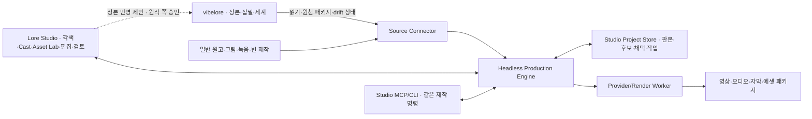

# Lore Studio — 소설에서 출발하는 독립 제작 작업실

2026-10-08. 사용자 요청에 따라 기존 [매체 제작 기초안](novel-to-media-production-architecture-2026-10-08.md)을 정확히 5회의 개선·비평 루프로 발전시키는 문서다. 제품 구조·구현 계약·화면 예시의 설계이며 운영 backend 구현 완료, 실제 음성·이미지 생성, 배포 완료를 뜻하지 않는다. 회차별 원문·실행 영수증·수정과 한계는 [루프 기록](studio-loop-2026-10-08/NOTES.md)에 남긴다.

## 결정: 독립 Studio + 공유 제작 엔진 + vibelore 원천 연결

**vibelore는 세계·인물·소설의 정본과 승인 흐름을 맡고, Lore Studio는 각색·배역·그림·음성·시간·결과물의 제작을 맡는다.** Studio는 별도 제품 경험과 프로젝트 저장소를 갖는다. 둘은 버전 있는 원천 패키지와 안정 ID로 연결한다. 같은 화면에 소설을 보여줄 수 있지만 저장 책임은 구별한다.



| 선택지 | 장점 | 비용과 판단 |
|---|---|---|
| vibelore MCP에 제작·UI까지 포함 | 연결이 쉬움 | 집필 서버에 UI·Chromium·과금·긴 작업이 결합. 이번 확장에는 권하지 않음 |
| Studio를 완전히 별개로 구현 | 자유로운 제품 | 인물·시점·근거·검토·복구를 다시 구현하게 됨 |
| 독립 Studio가 공통 제작 엔진과 Source Connector 사용 | 독립 실행·다른 원고·vibelore 연결을 함께 지원 | 스키마·판본 연결 관리 필요. 권고안 |

별도 제품이라는 것은 곧 원격 SaaS라는 뜻이 아니다. 첫 실행은 로컬 Studio 앱/localhost UI, 로컬 제작 daemon, 프로젝트 SQLite와 immutable blobs로 시작한다. vibelore MCP 서버는 Studio 없이도 집필·웹툰을 계속 제공한다. Remotion 등 renderer는 선택 패키지이고 [적용 라이선스](https://www.remotion.dev/docs/license/pricing)를 확인한다. vibelore의 Apache-2.0 라이선스가 renderer에도 적용된다고 표시하지 않는다.

## 사용자의 세 가지 시작점

1. **작품 연결:** vibelore 작품에서 선택 원문·장면 시점·인물·참조·공개 범위를 import한다. 지금의 source lock 계약을 재사용하되 소설 원문 전체 입력 보존을 보강한다.
2. **자료로 시작:** 일반 원고, 배경·인물 이미지, 실제 녹음 등을 project-local 원천으로 가져온다. 출처와 원본 bytes, 사용자 선택을 보존한다. vibelore를 설치할 필요가 없다.
3. **Studio에서 생산:** 빈 제작 브리프에서 각색 대본, 인물 표현 후보, 배경, 목소리 오디션과 샷을 만든다. 이것은 Studio-owned 제작 자료이며 외부 세계 정본을 자동 생성하거나 덮어쓰지 않는다. 세계 설정의 소유자를 정해야 하는 경우 source 단계에서 선택한다.

불완전한 자료에서도 시작할 수 있다. 캐릭터 참조만 있으면 원고를 연결하거나 Studio 대본을 쓰고, 원고만 있으면 디자인·배역 후보를 만든다. 준비되지 않은 asset slot은 placeholder임을 표시한다. 실제 생성 요청에 필요한 상태·배역·승인·예산이 없으면 그 job만 발급하지 않는다.

### Project와 Production

Project는 공통 cast·자료·배역·에셋 라이브러리를 담고 여러 Production을 가진다. Production은 본편, 예고편, 오디오판처럼 감상 목적·각색판·채택 집합·timeline을 가진다. 같은 narrative/timeline의 16:9와 9:16은 output profile과 reframe 선택으로 관리할 수 있다. 사건 선별·대사 순서가 달라지면 별도 Production이다. 예고편의 의상·배역 override는 본편에 전파하지 않는다.

project default → production override → scene override → shot override가 적용 범위의 해석 순서다. 각 scope에서 subject가 일치하는 slot만 해석하며, 한 manifest에는 최종 resolved revision을 pin한다. project default 개정도 기존 고정 샷과 완료 manifest를 자동 교체하지 않는다. 새 판본 사용 제안과 사용처 선택을 거쳐 working selection을 개정한다.

## 다인물: 인물·출현·배역·발화를 네 층으로 구별

```text
CharacterIdentity — 원작 인물 식별
       ↓
Occurrence — 이 장면의 이 출현; 시점·상태·지식·presence
       ↓
RoleBinding — 그 출현을 읽는 언어·표현·voice·연기 기본값
       ↓
Utterance — 대사·의도·문맥·상대·반응·선택 음원
```

`Occurrence`는 `id, sceneId, characterId?, temporalStateRef, knowledgeStateRef, presence, roleBindingId`를 가진다. presence는 onscreen/offscreen/voiceover/inner/narrator 등이다. 내레이터가 작중 인물일 수 있고 성인·어린 같은 인물이 한 장면에 나타나도 두 occurrence로 구별한다. 군중은 ensemble role이며 특정 발화가 필요하면 별도 occurrence를 만든다.

`CharacterIdentity{id, origin: source(packageId, canonId) | studioLocal}`의 원천을 기록한다. narrator·군중 role은 characterId가 없을 수 있지만 Studio가 만든 이름 있는 인물은 local identity를 가진다. `IdentityLink{localIdentityId, sourceIdentityId, actor, reason, supersedes}`로만 둘을 연결한다. 이름 일치로 자동 merge하지 않는다. link/unlink는 기존 occurrence·utterance·adoption ID를 보존한다. 별칭 metadata만 달라지면 음원 bytes를 재사용할 수 있지만 실제 생성 입력의 지식·상태·문맥이 바뀌면 그 digest에 맞게 invalidation한다.

CastingDecision은 project의 role+language 기본값, portrayal state별 override, production별 선택, occurrence별 override를 명시한다. 실제 job에는 해석이 끝난 RoleBinding revision을 넣는다. 특정 상태를 위한 casting과 production casting이 겹치면 해당 production의 같은 상태 키에 명시한 선택을 쓰고, 같은 specificity의 충돌은 unresolved로 반환한다. 엄마의 기본 배역을 바꾸면 엄마 binding을 상속하는 발화만 영향 목록에 나오고, 명시적 occurrence override와 과거 완료 음원은 유지된다.

카메라·시선·행동·발화 대상은 occurrence ID를 참조한다. 인물 이름을 foreign key로 쓰지 않는다. 단역도 안정 ID를 갖지만 이름·문서를 새 정본에 자동 추가하지 않는다. 지식은 인물별·시점별 자료를 참조하고 “화자니까 모든 정답을 안다”는 문맥을 주지 않는다.

작품 전체 Cast Library는 모든 인물을 담고, 장면 Cast는 출현한 사람만 담고, 타임라인은 현재 장면에서 실제 발화하는 track만 펼친다. 8인·40인 환경에서도 40개 track을 매번 펼치지 않는다. 검색·필터·collapsed group·offscreen 표시·미배정 voice queue를 제공한다. 실제 40인 실행 한계는 제품 성능 시험으로 결정하며 데이터가 인물 수를 2나 8로 제한하지 않는다.

화면의 track 필터는 실제 mute와 구별한다. 숨긴 내레이터 track이 렌더에서 사라져서는 안 된다. 여러 인물을 한 샷에 그릴 때 provider의 참조 인물 한도를 검사하고 coverage shots·승인된 그룹 참조·로컬 layer 합성·수동 편집을 선택한다. 8인 cast가 있다는 사실은 8명의 얼굴을 한 이미지 호출에서 일관되게 만들 수 있다는 뜻이 아니다. 같은 voice ID를 쓰는 서로 다른 배역도 합치지 않는다.

## Studio의 다섯 작업 공간

| 공간 | 주된 결정 | 계속 유지할 문맥 |
|---|---|---|
| Story | 원천·각색·장면 목적·공개 순서·압축 | 원문 근거, 판본 차이 |
| Cast | 인물 출현·외형 상태·배역·발음·오디션 | 원작 정체성과 scene occurrence |
| Asset Lab | 생성·가져오기·영역 수정·변형·reference 채택 | 기준 bytes, 변경 범위, 영향받는 slot |
| Edit | 실제 preview·발화·반응·카메라·음향·자막 | 선택 scene/shot/utterance |
| Production | 실행·예산·후보·검토·실패 복구·export | 각 job 입력과 선택한 판본 |

이동해도 현재 scene·shot·occurrence를 유지한다. 같은 버튼 이름이 다른 scope를 조용히 바꾸지 않는다. inspector의 첫 줄은 항상 “무엇을 수정하는가/어디에 적용하는가”다. 장면 수정 → 작품 전체 수정으로 범위가 넓어지면 영향 목록과 새 채택 결정을 보여준다.

## 이미지 생성·편집: Asset Lab의 기본 기능

지원 제작 행위는 generate/import/edit/crop/transform/matte/composite/upscale이다. 모든 행위가 AI 호출은 아니다. crop·위치·카메라·레이어 opacity는 결정론 편집으로 즉시 preview한다. 외형·표정·손·의상 수정과 새 배경은 승인한 provider의 generation/edit 요청으로 후보를 만든다.

### 수정 요청 계약

AssetSlot은 `id, kind, subject, language?, expressionProfileId?`를 갖는다. 인물 subject는 `characterId+appearanceStateRef`, 배경은 location identity+승인 상태, 소품은 prop identity+상태를 참조한다. subject가 다르면 같은 이름·같은 assetId 문자열만으로 전파하지 않는다. 어린 인물의 기준 수정이 성인 샷에 사용 제안으로 나타나서는 안 된다.

```text
EditRequest {
  baseAssetRevision, sourceBlobHash, targetSlot,
  operation, prompt, selectionInSourceCoordinates,
  maskBlobHash?, protectRegions[], referenceRevisions[],
  scope: shotOverride | sceneOverride | productionOverride | projectAsset,
  capabilityPolicyRevision, modelPolicyRevision, budgetReservation
}
```

선택 영역은 현재 화면 crop이 아닌 원본 좌표로 저장한다. 화면에서 확대·세로 reframe한 상태에서도 같은 영역을 가리켜야 한다. mask는 immutable bytes로 보존한다. provider가 native mask를 지원하면 사용하고, 지원하지 않으면 전체 이미지 편집 후보를 만든 뒤 명시적인 영역 합성·edge 검토 경로를 선택한다. 텍스트 prompt에 “밖은 그대로”라고 쓰는 것만으로 보호를 보증하지 않는다.

`CanonicalPixelSpace{decodedWidth, decodedHeight, orientationApplied, colorSpace, alphaMode}`를 기준으로 mask를 정의한다. provider의 crop/pad/scale/rotation은 명시한 역변환 recipe가 있을 때만 원본 공간으로 복원한다. correspondence가 불명확하면 local-composite를 막고 전체 이미지 후보로 검토한다. 보호 밖 보존은 파일 전체 hash가 아닌 **같은 canonical decode의 RGBA 픽셀 값**을 대조한다. PNG 재인코딩이 파일 bytes를 바꾸는 것과 실제 보호 영역 변화는 다르다.

보호 밖의 픽셀을 정확히 유지해야 하면 원본 bytes를 compositor가 유지한다. feather band는 수정 범위에 포함하고 경계·조명 연결을 검토한다. 이 합성이 자연스러운 손·그림자·가림 관계를 보장하지 않으므로 실제 후보와 composite을 모두 본다. 마스크 밖 semantic drift를 감지하는 모델 검토는 advisory/unclear를 보존하며 자동 정본 변경 권한이 없다.

### 후보 비교와 적용

전후 split, 전체 결과, mask/protected 영역, 실제 참조, 생성 설정과 비용을 보여준다. “이 샷만 사용”은 shot slot에 후보 revision을 채택한다. “작품 공통 참조로 채택”은 Studio project의 asset slot을 개정하고 그 slot을 참조하는 샷에 **새 버전 사용 제안**을 만든다. 고정된 기존 샷을 자동 교체하지 않는다. 공유 세계 정본·다른 작품·과거 제작 입력은 변경하지 않는다.

외형 변경이 원작의 사실 변경을 필요로 하면 vibelore로 “정본 변경 제안”을 전달한다. 적용은 원작 쪽 inspect/validate/apply와 영향 검토를 따른다. Studio 모델이 직접 `.vibelore/`, world/, characters/에 쓰지 않는다.

AssetRevision은 `origin, parents[], operationRecipe, sourceOrigin?, blobHashes[]`를 갖는다. origin은 import/generated/aiEdit/deterministicDerivative/composite이다. 원작 참조에서 파생됐으면 `sourceOrigin{packageId, sourceAssetId, sourceBlobHash}`와 부모 계보를 기록한다. rebase는 “원작 기준이 달라진 파생 채택”도 영향 목록에 넣는다. 선택은 기존 override 유지, 새 기준으로 재편집, 새 원작 참조로 복귀다. 어느 것도 선택하지 않은 pending rebase는 원래 고정 bytes를 유지하고 완료 처리하지 않는다.

모든 origin은 bytes 검사(decode·실제 형식·길이·sample rate·checksum)를 통과해야 candidate_ready가 된다. 실패 파일은 quarantine이며 채택할 수 없다. import도 생성과 같은 candidate/검토/채택 절차를 쓰지만 provider attempt나 API 비용을 가짜로 만들지 않는다. viewport crop·위치·카메라는 ShotTransform revision이고 asset bytes를 바꾸지 않는다. 명시적 “crop을 새 파일로 저장”, matte·upscale·합성은 부모가 있는 새 AssetRevision이다.

Candidate는 불변이다. `Adoption{slotId, revisionId, scope, actor, reason, supersedes, dependencyDigest}`가 사용할 자료를 가리킨다. actor는 human 또는 이름 있는 auto policy다. 되돌리기는 이전 adoption을 supersede하는 새 결정이며 audit log를 지우지 않는다. 생성·검토·채택·export는 각각의 상태다.

같은 base에서 만든 머리 수정 A와 손 수정 B를 순서대로 채택하면 B의 base와 현재 selection을 비교한다. 다르면 stale-base다. 원본 B로 대체, 새 base에서 재생성, 명확한 mask·역변환·영역 조건을 만족하는 결정론 재합성 중 선택한다. 재합성도 새 revision·새 composite 검토가 필요하다. B를 사용했다는 이유로 A를 조용히 지우지 않는다.

## 음성 생산과 편집

배역 오디션 생성, 녹음 import, 발음 사전, 연기 지시, take 비교, trim·fade·gain·노이즈 처리와 timing을 한 작업 흐름으로 둔다. provider voice ID는 자체 RoleBinding ID와 별개다. 유효기간·모델·API surface·샘플 bytes를 보존한다. 음성 복제 기능을 도입하는 경우 해당 provider의 실제 지원·동의 계약을 확인하며 기본 구현의 선행 조건으로 요구하지 않는다.

같은 occurrence는 고정한 배역으로 합성하고 감정은 PerformanceScore에서 달라진다. 발화 또는 명시적 generation group 단위로 만들며 한 TTS 파일이 여러 대사를 담으면 해당 group 전체가 재생성 범위다. provider의 다중 화자 상한은 프로젝트 등장인물 상한이 아니다. 현재 [Google 음성 계약](google-media-production-api-review-2026-10-08.md)은 두 화자 결과의 stem과 단어 타임코드를 보장하지 않으므로 이를 UI에서 분리 트랙처럼 표시하지 않는다.

take에는 실제 응답의 resolved model/version과 voice provenance를 기록한다. provider가 해석된 버전을 제공하지 않으면 unknown이며 재현성을 주장하지 않는다. voice 만료는 예약·dispatch 전에 확인하고, 대체 voice는 새 audition/배역 선택을 요구한다. 모델·voice 판본이 바뀐 새 take는 관련 인접 take의 voice-continuity 검토를 stale로 만든다. 예전 take의 trim·fade·gain stack은 새 take에 자동 복사하지 않는다. 호환 가능한 연산도 “이전 편집 재적용” 제안과 실제 청취를 거친다.

LLM은 intent/subtext/response/hold를 제안한다. 실제 WAV sample 길이로 발화 시간을 계산하고 프레임에 배치한다. 원문 표시와 발음 문자열·실제 음성을 각각 보존한다. 단어 자막은 확인된 alignment 자료만 사용한다. 음성 녹음·import도 original bytes와 editor operation stack을 보존한다.

## 의존성: 재사용 가능한 것과 검토가 필요한 것을 구별

정확한 generation input digest가 캐시의 기준이다. 실 input에 포함된 문맥 bytes가 바뀌면 새 요청의 정확한 캐시 hit라고 부를 수 없다. 사용자는 기존 take를 유지할 수 있지만 이것은 **새 문맥에서 재사용 채택**이며 이유와 relevance 검토가 필요하다.

`input-invalid`는 생성·검사 binding의 전제가 변한 상태다. `review-stale`은 실제 유지한 bytes는 같지만 인접 연기·전환·감상 문맥이 달라 다시 볼 상태다. 둘을 섞지 않는다. u3의 연기 지시만 바꾸고 u4의 고정 text context가 그대로라면 u3만 생성한다. u3의 대사 자체를 바꾸어 u4 생성 문맥에 포함되면 u4도 영향을 받는다. 전역 performance hash 하나로 전 take를 무효화하지 않는다.

카메라 수정은 음원·그림 생성 비용 0, timing 수정은 음원·그림 생성 비용 0이다. 어떤 take의 실제 길이가 바뀌면 관련 anchor와 뒤 시간 배치가 재계산된다. shot 이미지가 바뀌면 해당 shot·인접 transition·그 composite 검토가 stale이 된다. 변경 범위가 작은 mask라도 전체 composite의 검토는 새로 필요할 수 있다.

## 실행 계약과 복구

원칙: **프로젝트 저장은 원자적으로, 외부 청구는 결과 불명까지 정직하게.** SQLite transaction이 외부 API 호출을 원자적으로 만들어 주지는 않는다.

```text
Job: queued → preparing → running → candidate_ready → checked
                                     → adopted (별도 Adoption)
Attempt: prepared → dispatching(영속 commit) → succeeded | failed_definite | outcome_unknown
Cancellation: cancel_requested → cancelled_before_dispatch | detached_in_flight
```

command에는 commandId, expectedAggregateRevision, targetId, inputDigest를 둔다. project event cursor는 상태 조회·재연결용이고 사용자 편집 CAS는 slot adoption, utterance, timeline intent, casting decision별 revision이다. candidate/attempt 진행 event가 무관한 사용자 의도 aggregate의 revision을 올리지 않는다. command log·aggregate revision·outbox·budget reserve를 같은 write transaction으로 기록한 뒤 worker가 실제 호출한다. 같은 commandId+같은 digest 재전달은 기존 결과/job을 반환한다. 같은 commandId의 다른 payload는 거부한다. worker lease+fencing token으로 중복 commit을 막되 외부 요청 exactly-once 과금을 보장하지 않는다.

worker는 네트워크 호출 **전에** attemptId·requestDigest·leaseToken을 넣은 dispatching 상태를 commit한다. crash 후 남아 있는 dispatching은 실제 send 전이었을 가능성이 있어도 outcome_unknown으로 복구하며 같은 attempt를 blind 재전송하지 않는다. 새 worker는 provider 조회가 가능한지 먼저 확인한다. dispatch-intent commit 직후/send 직후/응답 수신 직후 종료를 각각 fault fixture로 둔다. 새 retry는 새 attemptId다.

전송 뒤 timeout·중단·접속 끊김은 outcome_unknown이다. operation 조회 계약이 있으면 확인하고, 없으면 무조건 재전송하지 않는다. 비용은 예약을 보수적으로 유지한다. 명시한 retry policy 또는 새 사용자 결정을 통해 duplicate-charge risk와 남은 예산 안에서 새 attempt를 만든다. 동일한 논리 job에도 attempt ID·request digest·provider request/operation ID를 구별한다.

늦은 결과는 현재 input digest와 비교한다. 일치하더라도 다른 attempt의 결과면 별도 candidate로 보존한다. 현재 입력과 다르면 stale candidate이며 auto-adoption하지 않는다. bytes write→checksum→immutable object 등록→candidate event 순서로 처리한다. 취소해도 외부 실행이 완료·청구될 수 있으며 UI에 표시한다.

event stream은 cursor 기반 재연결이다. snapshot과 cursor를 함께 읽고 그 뒤 event부터 적용한다. reload가 job을 재실행하지 않는다. optimistic edit와 실제 저장 실패를 구별하고 예상 revision이 다르면 conflict를 반환한다. 서로 다른 target의 동시 command는 비교·재기반할 수 있으나 같은 adoption slot이나 timeline intent 충돌은 마지막 쓰기 승리로 숨기지 않는다.

### 예산 ledger와 불명 결과 정산

BudgetLedger는 attemptId별 `reserved → settled | released | held_unknown`을 기록한다. reserve는 dispatch outbox와 같은 transaction에서 잔액 조건을 확인한다. 10건분 잔액으로 동시 20건 요청이 와도 10건 이내만 준비한다. released는 미전송이나 청구되지 않았다는 확정 근거가 있을 때만 가능하다. timeout은 held_unknown이며 임의 TTL로 잔액을 복원하지 않는다.

provider usage 조회·청구 내역·사용자의 “보수적으로 청구된 것으로 처리” 선택을 reconciliation decision으로 기록한다. 후자는 실제 청구 확인과 구별한다. UI에는 확정 사용·예약·불명 보류를 나누어 보여준다. retry도 별도 reserve가 필요하다. 예약 금액이 추정치라면 estimate임을 표시하고 실제 정산 차이를 기록한다. 최대 출력·단가의 검증된 상한이 없는 경우 application budget은 새 요청 발급 제한이며 provider invoice의 절대 상한이라고 보장하지 않는다.

## 정본·원천 drift와 검토 권한

SourcePackage는 원작 bytes·정체성·상태·설정·asset reference와 적용 scope를 고정한다. import된 immutable package에서 제작은 고정 입력만 참조한다. 연결 상태의 working-tree drift를 감지하면 관련 새 source 기반 작업을 blocked:source-drift로 표시하고 sync/rebase를 먼저 요청한다. 최신 source 변경과 고정 패키지 자체가 손상된 경우를 구별한다. 과거 manifest 재생·검증은 고정 bytes를 사용한다.

scope를 확인할 수 없으면 안전하게 넓은 범위에서 막고 unresolved 근거를 표시한다. “한 문단만 바뀌니 한 장면만 영향”은 source map·인물 상태 참조가 확인됐을 때만 성립한다. 각색 재고정은 explicit RebaseDecision과 source diff·영향 목록을 남긴다.

검토 finding은 deterministic, evidence-backed semantic, advisory로 구별한다. 인용이 존재한다는 것만으로 의미 충돌이 자동 확정되는 것은 아니다. semantic blocker는 현재 원천·발화·샷의 실제 근거를 함께 보여주고 해당 검토 계약의 판정 주체를 기록한다. 작가의 표현 선택을 새로운 정본 불변식으로 승격하지 않는다. enabled reviewer의 실행 실패는 내용 점수와 별개로 unverified이며 auto 완료를 guided로 낮춘다.

approval receipt는 artifact hash+dependency closure+review policy+actor에 묶는다. adoption/production publish transaction 직전에 재확인한다. 검토 중 이미지·폰트·대사·voice·출력 프로필이 달라지면 예전 승인으로 완료할 수 없다. 사용자가 끈 advisory review는 실패로 다시 추가하지 않는다.

### 고정 Edition과 편집 중 selection

ExportEdition은 resolved revision·actual bytes·timeline·profile을 묶은 immutable closure와 output manifest를 가진다. final approval은 `closureDigest+outputManifestDigest+reviewPolicyRevision`에 묶는다. publish transaction **안에서** receipt의 두 digest·render 입력·실제 출력 검사 대상·Edition 상태를 CAS로 확인하고 채택한다. 검토 대상 Edition의 bytes·dependency가 달라지면 승인 무효다.

사용자가 렌더 도중 working selection v2를 만드는 것과 Edition v1이 변하는 것은 다르다. 고정 v1의 승인·publish는 진행할 수 있고 “현재 편집본과 다름”을 표시한다. v2로 승인을 승계하지 않는다. 원천 rebase는 새 Edition의 입력을 만들며 과거 승인판을 덮지 않는다.

파일은 temp write→decode/checksum→필요한 fsync→content-addressed immutable rename→DB 등록 순서다. filesystem과 DB가 하나의 원자 transaction이라는 주장은 하지 않는다. 등록 전 orphan과 등록 후 missing/corrupt blob을 startup recovery에서 구별하고, 후자는 serve/publish를 차단한다. GC는 queued/dispatching/unknown attempt, candidate/adoption, 완료 manifest, active render, backup/export snapshot의 closure와 read lease를 보존한다. tombstone·유예 기간 후 reference를 다시 확인하며 현재 job·백업과 경합해 파일을 지우지 않는다.

## 모델·renderer 배치

기본 후보는 기존 [API 조사](google-media-production-api-review-2026-10-08.md)를 참조한다. 각색은 연결한 집필 모델 또는 Google 텍스트 모델, 그림은 Google 참조 이미지 편집 후보, 연기는 배역별 TTS, 의미 검토는 별도 request, 실제 출력은 공통 Remotion composition과 FFmpeg다. 이번 비평에는 실제 Claude Opus 5.5를 사용했으며 이 사실이 제품 기본 모델을 Opus로 확정한다는 뜻은 아니다.

capability snapshot에 API surface, model ID, text/image/audio limits, reference/mask/alpha support, output format, quota/pricing checkedAt, provider operation lookup을 둔다. 불명 기능은 지원으로 표시하지 않는다. 실제 계정 가용성과 생성 샘플로 배포 전 확인한다. [Google 모델 목록](https://ai.google.dev/gemini-api/docs/models), [Anthropic Opus 소개](https://www.anthropic.com/claude/opus).

내부 스키마의 타입·범위와 cross-reference는 모델 JSON과 별개로 코드에서 검증한다. 모델 결과를 JavaScript·shell·arbitrary file path로 실행하지 않는다. 실제 파일은 프로젝트 blob ID를 통해 읽고, 원고·asset prompt는 명령으로 취급하지 않는다. capability가 바뀌면 기존 bytes 재생은 유지하고 새 job만 새 정책으로 실행한다.

renderer는 timeline revision·선택 bytes·폰트·출력 profile·고정 환경을 입력으로 받는다. preview/export는 같은 frame function/composition이다. render 함수에서 API generation·현재 시간·미고정 random을 실행하지 않는다. export queue는 편집기 연결 없이도 작업을 끝내며 실제 파일 길이·코덱·대표 frame·audio mix 검사를 남긴다. bit-identical MP4를 모든 환경에 보장하지 않는다.

## 출시 게이트

설계 문서와 UI prototype이 통과하는 것만으로 production-ready라 부르지 않는다. 구현 출시를 막는 조건은 아래와 같다.

1. 8인·40인 cast, 같은 인물 과거/현재, offscreen/inner/narrator, ensemble의 연결·영향 시험.
2. 실제 한국어 배역 샘플의 누락·발음·반복·감정·동일성 청취와 source map 확인.
3. 원본 선택 좌표·mask·보호 밖 bytes·feather band·image edit lineage·shot/project 범위·undo 검사.
4. provider send 직후 worker 종료와 outcome_unknown, 늦은 stale 응답·중복 candidate·retry 비용 시험.
5. CAS 충돌·outbox recovery·lease expiration·event resume·disk full·missing blob·checksum 실패 시험.
6. 승인과 publish 사이 의존성 변경, disabled review, 못 듣거나 못 보는 환경, 정본 drift 차단 시험.
7. preview/export 실제 1-frame 동기 목표 측정, 16:9/9:16 safe reframe·자막·작은 화면·키보드 검토.
8. project backup/restore·schema upgrade/rollback·secret redaction·지원 bundle과 실제 비용 reconciliation.

첫 vertical slice부터 4명 이상+내레이터와 offscreen 출현을 포함한다. 이후 8인 샘플, 40인 UI/데이터 stress, 과거·현재 동시 출현을 회귀 fixture로 둔다. 초기 길이는 60~90초로 제한하되 cast를 2명으로 축소해 다인물 검증을 미루지 않는다.

## 구현 단계

- 단계 1: 별도 project store·Source Connector·Occurrence/RoleBinding·Candidate/Adoption·command/job 계약. headless fixture로 복구와 선택적 invalidation 검증.
- 단계 2: 로컬 Studio shell, 원문/장면/cast/Asset Lab, import와 비파괴 편집. 기능 없는 생성 버튼은 실행 가능한 것처럼 표시하지 않는다.
- 단계 3: 실제 provider 1개 연결, 이미지 edit·TTS 오디션·발화 생성·실제 비용·capability 탐지. 완전 자동 대량 제작 전에 장면 하나를 통과시킨다.
- 단계 4: 공통 timeline preview/export·최종 mix·검토·국소 수정·완료 manifest.
- 단계 5: 여러 장면 제작, 오디오판·세로판·예고편, 필요한 때 협업·원격 worker/클라우드 저장으로 이동.

API 표면은 `SourceConnector.export/verify`, `Production.command/status/events`, `Provider.generate/inspect/cancelCapability`, `Render.preview/export` 정도로 시작한다. 공개 방법이 많아지는 복잡성보다 각 interface 안에 locality를 모은다. 존재하지 않는 모든 provider나 분산 서비스의 추상 구조를 먼저 구현하지 않는다.

### vibelore 코드에서 실제 분리할 지점

현재 `resolveProductionSource`는 vibelore Store·workId·webtoon source·LoreScript 스키마를 직접 읽는다. 이 함수를 이름만 바꾸어 독립 Studio 엔진에 넣지 않는다. vibelore Adapter가 기존 도구·store를 통해 snapshot을 만들고, 제작 엔진에는 외부 경로가 없는 `SourcePackage` DTO와 blob reader를 전달한다. 원작이 없는 Studio 대본은 project-local identity·state·provenance를 사용하며 불필요한 소설 Foundation·loreRevisionId를 만들지 않는다. 필요할 때만 원작 identity와 명시적으로 link한다.

SourcePackage는 schemaVersion, sourceKind, sourceRevision, textUnits, sceneScopes, sourceIdentityMap, revealPolicy, blobManifest, preservationStatus를 가진다. renderer가 원작 폴더를 직접 탐색하지 않는다. 백업·portable bundle은 DTO와 실제 bytes·font·recipe·selection closure를 포함하고 checksum inventory로 검증한다. 외부 provider voice ID만 보존한 자료는 기존 음원 재생은 가능해도 새로운 같은 음성 생성은 보장하지 않는다.

### 로컬 제작 daemon의 기본 계약

loopback 바인딩과 origin/token 검증, 사용자가 연 프로젝트 범위의 blob serving, OS secret store, 로그·support bundle의 credential redaction을 기본으로 한다. UI에 provider key를 보내지 않는다. 임의 절대경로와 외부 URL을 에셋으로 자동 열거나 모델 결과에서 복원하지 않는다. 각 provider outbound 요청은 선택한 원문·참조·실제 bytes 목록과 목적·승인된 budget policy를 기록한다. 운영 telemetry는 request ID·stage·elapsed·usage 중심이며 원문·개인 credential을 기본 payload로 넣지 않는다.

지원 bundle은 project schema/renderer/provider capability 판본·job 상태·error 코드·입력/출력 digest를 담고 원문·음원·그림을 포함할 때는 그 범위를 보여준다. 이 운영 계약은 제품 출시 작업이며 이번 화면 prototype이 구현했다고 표시하지 않는다.

## 이번 결과의 증거 범위

운영 코드와 API 기능은 기초 보고서에서 확인했다. 이번에는 독립 모델 비평·문서 개선·로컬 화면 상호작용 검증을 한다. 실제 그림·음성 모델 호출, 실제 한국어 audition, durable backend·동시성·과금·영상 인코딩 시험은 아직 하지 않았다. 실행하지 않은 출시 게이트에는 통과 표시를 하지 않는다.

세부 비교·타입·acceptance matrix는 [제품 경계 연구](studio-product-boundaries-2026-10-08.md), [생산 계약 연구](studio-production-contracts-2026-10-08.md)에 있다. 이 통합 문서가 현재 권고이며 기초 문서·별도 연구의 미반영 초안과 차이가 있으면 여기의 명시적 계약을 우선 읽는다.
