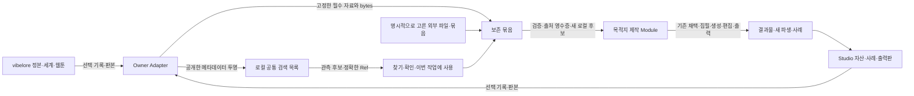

# 제작 자산 순환 상세 설계

2026-10-21 · Superpowers brainstorming의 written design. **상태: 상세 설계 제안, 제품 코드 미착수.** 사용자가 승인한 방향은 장르·스타일 제약 없는 제작 확장과 여러 제작 사이클의 자산 축적·재사용이다. 아래 저장 방식·Interface·초기 범위·수치 한도는 작성자가 제안한 기술 결정이며 사용자가 각각 선택한 것으로 보고하지 않는다.

출발점은 [제품 방향](../../research/2026-10-21-video-production-extension.md), [실제 구현 지도](../../research/2026-10-21-video-extension-implementation-map.md), [용어](../../../CONTEXT.md)다. 식별·반입·상태 계약은 [상세 계약](2026-10-21-creative-asset-cycles-contracts.md)에 둔다. 이 두 문서가 하나의 설계이며 과거 연구 문서의 영상 스타일 예시보다 우선한다.

## 1. 사용자 경험과 성공 기준

사용자는 소설을 쓰거나 고치고, 웹툰을 만들고, 필요하면 음성·음악·동작·영상으로 더 제작한다. 그때 생긴 원문·인물·그림·소리·동작·결과·선택 근거가 다음 작업에서 찾아 쓸 수 있는 자료로 남는다. 각 제작은 필요한 기존 자료를 고르고 부족한 부분만 보탠다. 원고·이미지·녹음이나 독립 아이디어에서도 시작할 수 있다.

첫 완성 기준은 **세 사이클 동안 같은 자산의 발견 → 목적지 반입 → 필요한 파생 → 사용 결정 → 다음 재사용**이 실제로 이어지는 것이다. 자산 수나 검토 점수 증가가 성공 지표는 아니다. 사용자가 고른 옛 판본을 쓸 수 있고, 새 자료가 생겨도 과거 결과는 유지되어야 한다.

고정하지 않는 것: 장르, 화풍, 질감, 귀여움, 낭독/대화 비중, 캐릭터 수, 종이/컷아웃 같은 표현, 공급자, 모든 작업이 거치는 매체 순서. 실제 기술의 현재 한계는 해당 작업의 자료·능력 부족으로 설명한다.

첫 범위는 단일 사용자·로컬의 명시적으로 등록한 vibelore 작품/세계와 Studio 프로젝트다. 클라우드 협업·공개 marketplace·중앙 과금·전역 자동 생성은 별도 요구가 생길 때 다룬다. 현재 소설/웹툰 workflow·비활성 검토·hard/advisory·정본 채택 경계는 기존 경로를 유지한다.

## 2. 검증된 구현 기준선

| 위치 | 읽은 실제 상태 | 설계에 미치는 영향 |
|---|---|---|
| `/Users/lyoojk/vibelore` | HEAD `b3200d39050ccd627e67015a1b0619cea31b0d72`와 다수 기존 변경, 현재 `studio/` 없음 | 작업 트리 기능과 커밋된 기능을 구분. 기존 변경을 복사/초기화하지 않음 |
| 별도 `codex/lore-studio-local-production` 작업 트리 | HEAD `26b0bca3ad0e0658d7a97a64eeda0d9c90ebfc49`, 확인 시 clean | 구현 출발점은 이미 있는 Studio. 이 설계가 병합 완료를 뜻하지 않음 |
| `ai-content-studio` | HEAD `60291fac9a5122667a67d30bbd3b7fca4d82e909`, 미추적 별도 프로젝트 유지 | 한 작품의 제작·비교 근거와 선택 자산. 제품 전체의 기본 스타일·최선 모델이 아님 |

Studio에는 프로젝트별 blob, command replay/CAS, 후보·파생·채택/undo, job/attempt와 결과 불명 처리, 원천 rebase, Edition·backup이 있다. 전프로젝트 자산 검색·외부 계보를 보존하는 반입·범용 동작·독립 BGM/SFX·무성 시간은 추가 대상이다. 현재 `asset.import`는 image/audio만 받고 lineage의 부모는 비어 있다. `openStudio`는 초기화·복구를 실행하므로 원천을 읽기 위해 무조건 열어서는 안 된다.

실제 접합점: [Studio Interface](/Users/lyoojk/.codex/worktrees/lore-studio-local-production/vibelore/studio/src/engine/index.js), [반입·파생](/Users/lyoojk/.codex/worktrees/lore-studio-local-production/vibelore/studio/src/assets/commands.js), [채택](/Users/lyoojk/.codex/worktrees/lore-studio-local-production/vibelore/studio/src/engine/adoptions.js), [job 재사용](/Users/lyoojk/.codex/worktrees/lore-studio-local-production/vibelore/studio/src/engine/jobs.js), [원천 갱신](/Users/lyoojk/.codex/worktrees/lore-studio-local-production/vibelore/studio/src/engine/rebase.js), [Edition closure](/Users/lyoojk/.codex/worktrees/lore-studio-local-production/vibelore/studio/src/render/closure.js), [세계 에셋](../../../src/store/asset-catalog-store.js).

## 3. 저장 구조의 선택

실제 코드를 읽은 세 설계 에이전트가 서로 다른 안을 제안했다.

| 안 | 소유와 이용 방식 | 얻는 것 | 부담 |
|---|---|---|---|
| A 중앙 보관 | 공통 Library가 파일·의미 판본·근거를 보존하고 제작 쪽으로 연결 | 원천 offline에도 탐색·반입 가능, 전역 보존 | 새 중앙 backup/GC/복구·권한을 운영. 기존 Edition을 위해 목적지 복제도 당분간 필요 |
| B 연결 목록 | 원래 소유자의 메타데이터를 함께 찾고 사용할 때 목적지에 보존 반입 | 정본·제작 소유권 유지, 검색 목록 재구성, 기존 엔진 활용 | 원천 또는 보존 묶음이 없으면 새 반입 불가. 프로젝트별 bytes 중복 |
| C 묶음 교환 | 선택 자료를 닫힌 묶음으로 내보내고 다음 제작에 반입 | 작은 범위·offline 전달·추적이 명확 | 묶음만으로는 여러 제작의 자료를 함께 찾기 어려움 |

**제안은 B + C다.** Library Module은 연결·검색을 맡고, 정확한 자료 전달은 닫힌 묶음을 사용한다. 목적지에 보존한 뒤 원천과 검색 목록의 수명에 의존하지 않는다. 처음부터 중앙 blob 소유자를 추가하지 않는다. 추후 용량 문제가 측정되면 물리 저장 중복 제거를 별도로 검토한다.

### 책임과 소유권

| Module | 소유하는 것 | 맡기지 않는 것 |
|---|---|---|
| 기존 vibelore | 정본·세계·원문·StoryProfile/아크·집필/웹툰 승인 | Library가 정본에 역쓰기 |
| 기존 Studio | 대본·표현·자산 후보/채택·job/예산·Edition·보존 bytes | 검색 목록이 제작 완료를 판정 |
| Library | 명시적 등록 설정, 검색용 관측 투영, owner별 관측 token | 파일 원본·정본·채택·실행의 권위 |
| Owner Adapter | 소유자별 읽기·허용 범위·정확한 export | 기계 전체 탐색·원천의 자동 초기화·재시도 |
| Reuse Module | 선택 묶음 검사, 목적지 대응 검토, 원자적 출처 반입 | 원격 job을 새 로컬 생성으로 위장하거나 외부 채택 승계 |

Library 등록 설정은 사용자의 선택이므로 영속 보존한다. 검색 투영은 재구성할 수 있다. 색인 삭제는 등록 설정·실제 에셋·목적지 영수증을 삭제하는 동작이 아니다. 전 소유자를 아우르는 단일 트랜잭션이나 같은 시각의 snapshot은 약속하지 않는다.

## 4. 자료 모델과 판본

기본 자료형은 원천/파생 에셋·원문 선택·제작 사례·결과판이다. 실제 mediaKind는 text/image/audio/video/structured로 구별하되 색인에 보인다는 사실과 반입·검사·편집·렌더 지원은 따로 표시한다. 장르/화풍은 선택 metadata이며 허용 목록으로 진입을 막지 않는다.

식별은 **소유자 + 프로젝트/작품 + 기록 종류 + 기록 ID + 판본**이다. 파일 hash는 bytes 동일성에만 쓴다. 같은 PNG가 두 인물의 자료라면 의미 기록은 둘이다. 경로·이름·같은 voice ID로 인물이나 에셋을 합치지 않는다. 원래 ID/판본 문자열은 opaque로 보존하고 vibelore의 `sha256:` 표기와 Studio의 64자리 hex를 무리하게 통일하지 않는다.

| 개념 | 담는 내용 | 판본 규칙 |
|---|---|---|
| `OriginRef` | owner/project/kind/recordId/revision | 정확한 과거 기록을 지칭. `latest`는 채택/묶음에 저장 불가 |
| `LibraryEntry` | Ref, 명시적 검색 정보, 표현 역할, 관측 token·가용성 | 원본 기록의 관측 사본. 검색 결과 자체는 사용 승인 아님 |
| `AssetBundle` | 선택 roots, 필수 소비 의존성·bytes, 원천/부모·선택 근거 | manifest hash로 고정. 실행용 의존성과 역사 참고 링크를 구분 |
| `ReuseInspection` | 묶음과 목적지 판본, 인물/상태/대사 대응, 필요한 선택 | 목적지/선택 변경 시 재검사. 모델 취향 점수 gate 아님 |
| `ImportReceipt` | 원천 Ref·묶음 hash·파일 hash, 새 로컬 후보, 용도/대응/actor | 목적지에서 반입과 함께 원자적으로 저장. 원천 채택과 다름 |
| `CycleRecord` | 목적, 선택 원천, 실제 실행/채택/출력 참조, 이전 사이클 | 해당 제작 소유자의 작업 기록. 별도 단계 조정기 아님 |
| `ProductionCase` | 실제 과제/조건·입출력·관찰·선택·평가자·불명값 | 새 관찰은 추가 기록. 과거 관찰을 최신 결과에 덮어씌우지 않음 |

`CycleRecord`는 기존 workflow/job/채택/Edition 이벤트의 정확한 참조를 묶는다. 다른 workflow의 상태를 복제해 집필 순서를 제어하지 않는다. Studio 밖의 실제 집필을 기록할 때는 발행/검사 영수증 등 소유자가 제공한 관측 근거를 연결한다. 아직 안 한 일은 계획으로 표시하며 실제 자산/실험으로 등록하지 않는다.

## 5. 작은 Interface와 사용 흐름

외부 호출자는 Library의 **등록/해제, 조회**와 Reuse의 **검사/반입**을 사용한다. 생성을 Library에서 시작하지 않는다. 정확한 함수·DTO·실패 코드는 [상세 계약](2026-10-21-creative-asset-cycles-contracts.md#공개-interface)을 따른다. 기존 Studio `command/snapshot/events/readBlob`는 유지한다. 새로운 명령은 기존 command replay·CAS·prepare/최종 commit 규약 안에 등록한다.

사용자 흐름은 ‘관련 자료 찾기 → 원본·사용 범위 확인 → 이 작업에 가져오기 → 필요한 부분만 제작 → 사용/출력’이다. 기존에 맡긴 범위와 auto 정책 안의 결정은 다시 묻지 않고 actor·근거를 기록한다. 새 사용 범위나 식별 대응처럼 실제로 미정인 선택만 드러낸다. 반입·채택이 별도 동작인 내부 구조 때문에 매번 중복 승인 화면을 강제하지 않는다.

1. **등록:** 사용자가 고른 저장소와 허용 프로젝트/작품만 연결한다. 다른 폴더·하위 프로젝트를 자동 발견·등록하지 않는다.
2. **찾기:** 원문/인물·상태·용도·매체·원천/파생·사례로 필터한다. 완료/후보/반려·현재 미확인 상태를 구분한다. 검색 문장과 과거 prompt는 실행 지시가 아닌 자료다.
3. **확인:** 선택한 정확한 판본과 필요한 실제 파일·관찰을 본다. 새 판본 발견, 원천 offline, 고정한 bytes 부재는 서로 다르게 표시한다.
4. **보존 묶음:** 원천이 읽을 수 있을 때 선택 자료와 필수 의존성을 고정한다. 별도 파일 묶음을 이미 받았다면 원천 연결 없이 같은 경로를 쓴다.
5. **반입 검사:** 목적지 인물/상태·언어·실제 대사·표현·사용 용도에 대응시킨다. 쓸 수 없는 발화는 음색 참고 등 다른 용도를 선택하거나 새로 제작한다.
6. **목적지 반입:** bytes를 보존하고 실제 decode·hash·현재 pins를 확인한다. 새 로컬 후보와 출처 영수증을 같은 commit에 확정한다. 반입 성공은 새 생성 성공/채택이 아니다.
7. **기존 사용 결정:** Studio의 `candidate.adopt`, vibelore의 해당 승인 흐름 등 목적지의 기존 경로를 따른다. 필요한 파생·실행은 기존 job/attempt에서 처리한다.
8. **재축적:** 새 자산·출력·판단 근거를 원래 제작 소유자에 남기고 명시된 범위만 검색에 공개한다. 하나의 샷 채택을 공통 기준이나 정본으로 자동 승격하지 않는다.

## 6. 반입의 의미와 동시성

반입은 새 사용처를 만든다. 외부 candidate ID를 내부 `parentCandidateIds`에 넣지 않는다. 외부 부모는 `originRef`로 보존하고 새 프로젝트 내부 파생은 기존 local parent 관계를 사용한다. imported raw/canonical bytes와 외부 출처 영수증은 연결하되 과거 job/attempt가 목적지에서 실행됐다고 쓰지 않는다.

현재 `asset.import`의 decode·격리·CAS를 재사용하는 `asset.importBundle` 명령을 제안한다. handler가 다른 `command`를 중첩 호출하지 않고 내부 준비/검증 함수를 공유한다. 원문은 기존 source 반입 경로, image/audio는 asset 반입 경로로 보낸다. 단계가 여러 개인 자료도 쓰기 소유자는 목적지 하나다.

첫 쓰기 대상은 Studio다. 한 asset command는 선택 root 하나·목적지 slot 하나와 필수 자료를 원자적으로 반입한다. 원문과 여러 에셋을 고르는 화면은 각각의 receipt를 가진 진행 묶음이며 전역 transaction이 아니다. 일부 성공은 보존하고 미완료 항목만 재개한다. vibelore를 목적지로 쓸 때의 참조 선택·공통 기준 채택은 기존 도구/승인 경로를 계속 사용하고 새 자동 정본 writer는 만들지 않는다.

원천 selected-content bytes는 그대로 보존하고, 목적지의 버전 고정 decoder가 소비용 canonical을 만든다. hash가 달라지면 `normalized-from` 기술 파생으로 기록하며 새 모델 생성이나 원천의 동일 실행 자료로 가장하지 않는다. 검사와 반입의 canonical 예상 hash가 같아야 한다. 새 로컬 후보 ID는 서버가 발급하므로 중복 판정은 그 ID 대신 원천·목적지 의미·용도·normalizer 판본으로 한다. 세부 규칙은 계약 부록을 따른다.

소유자 읽기와 목적지 쓰기 사이의 전역 transaction은 없다. 묶음은 이미 고정된 값이다. 목적지에서는 expectedRevision과 inspection의 묶음/대응 hash를 최종 재확인하고 command replay를 먼저 처리한다. 변경 충돌이면 후보/채택을 만들지 않는다. bytes staging은 기존 lease·GC 규약을 사용한다. 확정 뒤 응답 유실은 같은 commandId로 영수증을 재조회하며 새 생성·중복 채택을 시작하지 않는다.

Library 투영은 owner별 snapshot token 뒤의 관측만 반영한다. 오래된 응답이 새 투영을 덮거나 등록 해제 후 늦은 결과가 되살아나지 않도록 등록 generation을 비교한다. owner의 revision/cursor를 다른 owner와 숫자로 비교하지 않는다. 이벤트를 해석할 수 없거나 cursor가 끊겼으면 해당 owner만 새 snapshot으로 다시 만든다.

## 7. 자료별 재사용 계약

| 자료 | 유지할 것 | 새 사용 시 확인 |
|---|---|---|
| 소설·장면 원문 | 정확한 bytes·구간·화자·정본/공개 범위·원천 판본 | 원문 보존 각색과 별도 변형을 구분. 자동 재집필/정본 반영 없음 |
| 인물·배경 이미지 | 정체성·상태·표현 역할·원본/파생·해상도/alpha | whole-scene/identity/style/edit-target 용도를 구분. raster가 자동 레이어/rig가 되지 않음 |
| 발화 take | 정확한 발화·화자·언어·voice/연기 조건·원본/편집 | 새 대사에는 같은 take를 쓰지 않음. 타이밍만 바뀐 재사용과 새 연기를 구분 |
| 음악·효과음 | 원본·사용 구간·관측 조건·이용 범위 불명값 | 독립 트랙으로 선택. 대사나 원래 작품의 감정 구조를 강제하지 않음 |
| 동작·표현 묶음 | pose/rig/anchor·좌표·연기 cue·시간 기준·지원 한계 | 다른 디자인/체형/카메라에 그대로 호환된다고 가정하지 않음 |
| 생성 video/완성 영상 | 원본 clip/출력판·시간/소리·제작 입력·실제 결과 | 재생/trim/decode/render capability를 각각 확인. 자동 편집 자료 분해를 약속하지 않음 |

세 상태축을 나눈다: **보존/가용성**, **현재 사용처와의 대응**, **선택·검토 상태**. 오래된 판본도 보존돼 있고 현재 용도에 맞으면 쓸 수 있다. 최신판이라고 자동 적합하지 않다. hard 계약 오류는 거부하되 표현 취향·원작자의 유연성·critic advisory는 기존 정책을 따른다.

## 8. 제작 능력의 확장 Seam

공통 자산 순환과 실제 제작 능력을 나눈다. `OwnerAdapter`는 두 실제 소유자(vibelore/Studio)의 읽기를 연결한다. provider Adapter는 새 bytes를 공급하고 renderer Adapter는 선택 자산과 시간을 출력한다. host 내장 이미지·Fish/Suno UI는 지원 도구를 가진 호스트가 실행하며 로컬 worker의 직접 브라우저 접근으로 가정하지 않는다.

| 능력 | 현재 기반 | 추가할 범위 |
|---|---|---|
| image/audio/text | 기존 반입·원고·provider job | 교차 제작 출처/목적지 사용 연결 |
| 캐릭터별 표현 | 현 frameAt은 shot 이미지 하나와 카메라 | 인물 layer·포즈/표정·시선/반응·가림·접촉. 어떤 스타일로 표현할지는 작품 선택 |
| 선택적 소리·시간 | 현 timeline은 발화 take가 필요, mix도 take 중심 | speech/music/SFX 독립 트랙, 발화 없는 장면 시간, 실제 길이 anchor |
| video clip | 현재 import는 image/audio | clip decode·duration·trim·time mapping·음향·Edition closure·renderer |
| 생성 호스트 연결 | 기존 job/attempt/unknown과 파일 import | 실행 전 의도 고정, 실제 서비스 입력/결과 ID·관측값, 결과 불명 수습 후 수령 |

검색·보존만 지원하는 자료를 렌더 가능이라고 표시하지 않는다. capability는 `discover/preserve/inspect/derive/render`를 각각 보고한다. 새 공급자나 renderer를 붙여도 인물 ID·원천·이력·판본을 다시 만들 필요가 없도록 한다. 아직 실제로 변하지 않는 기능까지 범용 노드 그래프로 추상화하지 않는다.

## 9. 제작 사례와 평가

과거 자료는 `accepted-example`, `matched-comparison`, `failed-trial`, `unobserved`를 구분해 보존한다. 이 분류는 감상 품질 점수가 아니다. 비교군 없는 승인 영상을 공급자 우승 기록으로 승격하지 않는다. fixture/계약 시험을 실제 생성·감상 근거로 추천하지 않는다.

사례는 질문·고정 입력/참조/실제 필드·출력·비교군·관측 구간·평가자 관계·선택 이유·비용/권리 불명값을 연결한다. 다른 조건이면 차이를 보여주고 참고 후보로만 제시한다. 별도 agent ID·JSON·hash로 정직한 감상이나 독립 독자를 증명했다고 주장하지 않는다. 사용자 평가가 새로 들어오면 해당 과제/판본의 기록을 추가한다.

첫 추천은 설명 가능한 조건 일치와 명시적 사용 이력으로 충분하다. 사용자 취향을 하나의 전역 점수로 만들거나 자동 선택 정책을 추가하지 않는다. ‘잘된 사례’만 남기지 않고 왜 버렸는지·어디서 실패했는지도 보존한다.

## 10. 보존·이동·공개 범위

목적지에 보존 반입한 자료와 필수 closure는 원천 또는 Library가 없어도 열리고 사용 가능해야 한다. 원천의 이후 변경·철회·새 허용조건을 offline에서도 안다고 표시하지 않는다. 재연결 시 새 관측을 추가하며 과거 provenance를 고쳐 쓰지 않는다.

내보내기는 선택 자료와 소비에 필요한 문맥만 포함한다. 정본의 author-only/미래 문서·전체 prompt 로그를 기본 복사하지 않는다. redaction으로 필요한 증거가 빠지면 incomplete로 표시한 새 묶음을 만든다. hash는 파일의 일치이며 출처 진위·사용 허락의 증명은 아니다.

첫 묶음은 압축/실행 포맷이 아닌 manifest+내용 hash 파일 디렉터리다. key·cookie·토큰·활성 서비스 세션·자동 fetch URI를 담지 않는다. 경로는 connector-private 설정에만 둔다. 반입은 허용 필드·실제 파일 길이/hash·참조 closure·지원 판본을 확인한다. 상한과 실패 규칙은 상세 계약을 따른다.

새 저장 레코드가 GC/backup/Edition에서 빠지지 않게 해야 한다. 목적지의 외부 hash는 local blob ID 필드에 넣지 않고, 필요한 근거를 보존한 local manifest blob만 기존 GC의 참조로 연결한다. 새 reader/보존 구조를 모르는 구버전이 프로젝트를 조용히 열지 않도록 Studio DB의 명시적 새 버전·기존 자료 migration과 복구 시험을 구현 계획에 포함한다. Library 읽기는 원천 DB를 migration하지 않는다.

## 11. 세 사이클과 실패 시나리오

| 단계 | 실제로 이어져야 할 자료 | 확인 |
|---|---|---|
| Cycle 1 | 소설/편집 원문 S1·인물 R1 → 웹툰 W1·기준 그림 A | 서로 다른 자료 역할과 판본, 실제 채택/반려 근거 보존 |
| Cycle 2 | 다른 제작에서 S1/A/W1 선택 반입 → 필요한 A2·take B·결과 E2 | W1 전체 사용/참조/파생 선택, 새 제작만 실행, 원천 없이 보존본 소비 |
| Cycle 3 | 새 에피소드·대사·표현에서 A/A2/B 선택 → 필요한 B2와 E3 | 대사 변경과 시간만 변경을 구분, E2 불변, 새 선택/계보가 다시 검색됨 |

별도로 독립 대본·소리만 출력·음성 없는 장면·다른 스타일/제작 기술 조합에도 같은 계보/선택 흐름을 적용한다. 예시는 제품의 장르/화풍/인원수 제한이 아니다.

| 실패·변경 | 기대 결과 |
|---|---|
| 같은 파일·다른 인물/세계선 | bytes만 같고 의미는 별도. 자동 identity 병합 없음 |
| 오래된 색인/원천 offline | 관측 시각·가용성 구분. 반입 전 원천 부재는 실패, 보존 반입 뒤 소비는 유지 |
| 등록 해제·이동·복제 owner | 늦은 투영 부활 방지. 위치 재연결/별도 복제 등록은 명시적 선택 |
| 원고·대사·상태 변경 | 영향과 대응을 다시 확인. old take 자동 사용·전체 자산 일괄 폐기 모두 피함 |
| 반입 중 목적지 편집 | 최종 CAS 충돌, 채택 없음. 정상 replay와 새 입력을 구분 |
| 반입 확정 뒤 응답 유실 | 같은 command ID는 같은 영수증. 새 provider 실행 없음 |
| 단일 파일 손상/필수 의존성 부재 | 부분 반입을 성공 후보로 만들지 않음. 원본과 기존 후보 유지 |
| 사용 취소/새 기준 채택 | 현재 사용처만 새 결정. 과거 Edition/다른 제작판 유지 |
| 잘린 감상·synthetic proof | 실제 감상/전체 품질 합격으로 보고하지 않음 |
| 새 형식·미지원 schema | 명시적 미지원. 파일명·설명만으로 render-ready 승격 없음 |

## 12. 구현 단위와 수용 기준

이 절은 개발 범위 분해다. 테스트 코드·명령까지 고정하는 Superpowers writing-plans의 실행 계획은 이 상세 설계 검토 뒤 작성한다. 이번 요청에서 제품 코드를 시작하지 않는다.

1. **기준선/연결 확인:** 기존 Studio branch와 현재 사용자 변경의 통합 접합점을 확인한다. 등록 원천은 읽기 전용이다. 첫 작업은 이미 있는 엔진을 다시 만드는 scaffolding이 아니다.
2. **보존 재사용의 한 줄:** 정확한 export → 묶음 inspect → 목적지 출처 반입 → 기존 채택 → 파생 → 재수출. 두 프로젝트와 원천 제거 후 소비, 같은 command replay, 목적지 편집 충돌, GC/backup/restore까지 통과해야 한다.
3. **찾기와 사례 연결:** vibelore/Studio 두 Owner Adapter와 공통 검색 투영, owner별 갱신/해제/재구성, 계보·관측·사용처를 붙인다. 목록을 지워도 프로젝트와 영수증은 성립해야 한다.
4. **새 표현과 소리:** 실제 제작 목적에서 필요한 인물별 표현과 독립 소리/무성 시간을 추가하고 같은 preview/export·Edition을 사용한다. 기존 영상 스타일을 수용 기준으로 강제하지 않는다.
5. **세 사이클 종단 확인:** 위 시나리오를 서로 다른 목적/표현에서도 확인하고 중복 제작 회피·수정 범위·실제 비용/시간·품질을 기록한다. 새 공급자/clip은 실제 필요와 입력/비용이 준비됐을 때 후속 능력으로 붙인다.

제안 파일 책임은 상세 계약 끝의 지도를 따른다. 큰 개발 계획 하나로 모든 provider/renderer를 동시에 구현하지 않고, 위 단위마다 쓸 수 있는 결과와 실제 실패 검증을 갖춘다.

## 13. 작성자가 정한 기본값과 미실행 범위

- 로컬·단일 사용자·명시적 소유자 등록, B+C 보존 방식, 프로젝트별 목적지 bytes 복제.
- 기존 원천 소유권·채택·작업 권한 유지. 중앙 Library는 새 정본/생성 엔진이 아님.
- 첫 소비 지원은 기존 text/source·image/audio 경로. 다른 매체도 발견/참고할 수 있으나 지원 능력은 별도로 표시.
- 장르·스타일·인원수 기본 제한 없음. 자료 종류·소유자·대상판본·실제 capability의 계약만 검사.
- 자동 프로젝트 스캔/등록, 자동 공통 기준 승격, 자동 정본 역반영 없음. 사용자에게 이미 위임받은 제작 선택은 유지.

이번에는 소스·문서를 읽고 상세 설계와 용어를 작성했다. 실제 새 기능·migration·반입·생성·감상·유료 실행·새 테스트를 완료한 것으로 보고하지 않는다. 과거 통과 테스트 수는 이번 설계의 새 기능 합격 근거가 아니다.

### Builder check 결과

Superpowers의 `builder-check-prompt.md`를 받은 새 에이전트가 두 설계 문서를 읽고 실제 Studio 코드와 대조했다. 추가 답변 없이 계획을 세울 때 중요한 빈틈만 질문하도록 했다. 세 질문을 한 번의 통합 수정으로 해결했다.

| 질문 | 작성자가 확정한 제안 |
|---|---|
| 새 command와 새 후보 ID가 중복 반입을 어떻게 결정하는가 | 요청 후보 ID 제거, 서버 발급. replay와 의미 중복 키를 구분하고 유효한 기존 후보의 실제 ID를 반환 |
| 원문·여러 에셋을 함께 가져올 때 원자성은 어디까지인가 | 첫 writer는 Studio. 한 asset root/slot+필수 자료만 원자적 반입. 원문/다른 root는 별도 receipt를 가진 부분 진행·재개 |
| 원본 canonical과 목적지 decoder 결과가 다르면 무엇을 쓰는가 | 원천 selected-content는 그대로 보존. 목적지 canonical을 실행하며 변경은 normalized-from 기술 파생으로 기록 |

수정 후 같은 검토자가 해당 계약을 다시 읽고 **중요한 잔여 질문 없음**으로 답했다. 위 결정들은 사용자에게 새로 확인한 선호가 아니라 기존 의도와 구현 규약을 근거로 작성자가 제안한 값이다. 같은 호스트의 별도 설계 검토이며 실제 작품 감상·독립 독자 검증은 아니다. 사용자만 답할 수 있는 추가 제품 선택은 이번 check에서 나오지 않았다.
